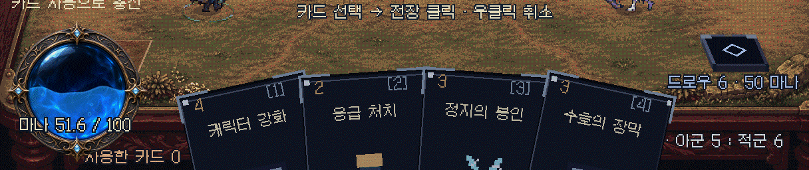

## 작업 결과

Godot 전투에 적용하고 프로젝트 main에 f1f16d69를 푸시했습니다.

## 변경 내용

### 적용 내용

플레이어 쪽 오른편의 드로우 위치를 기준으로 왼쪽 더미를 좌우 반전해 배치했습니다. 마나 UI와 겹치는 카드 면은 뒤로 두고 사용한 카드 장수는 마나 UI 아래로 옮겼습니다.

## 검증

Godot 4.7.2에서 사용한 카드 1장이 마나 UI 뒤에 놓이고 드로우 더미가 같은 높이에 표시됨을 실제 캡처했습니다. 10프레임 모두 달랐습니다. Chrome 헤드리스에서 대시보드 두 섹션의 새 캡처 표시를 확인했습니다. 현 작업 트리 빌드 25.57초, 초기 HTML +1,597바이트(병행 변경 포함), 지연 로드 캡처 참조 용량 −577,231바이트, 대상 섹션 캡처 2개와 5개. 

## 남은 사항

로컬 대시보드 HTML에는 병행 변경도 포함되어 이번 게임 변경 커밋에서 제외했습니다. 공개 Pages와 게임 패키지 배포는 미확인입니다.

## 작업 시간

- 제안 시간: 5분
- 실제로 완료된 시간: 2026-11-23 00:08~00:12 KST, 약 4분. 구현·Godot 검수·대시보드 표시·프로젝트 푸시 기준.
- XERJ: 미사용 — Godot 실제 화면과 헤드리스 브라우저로 확인.
