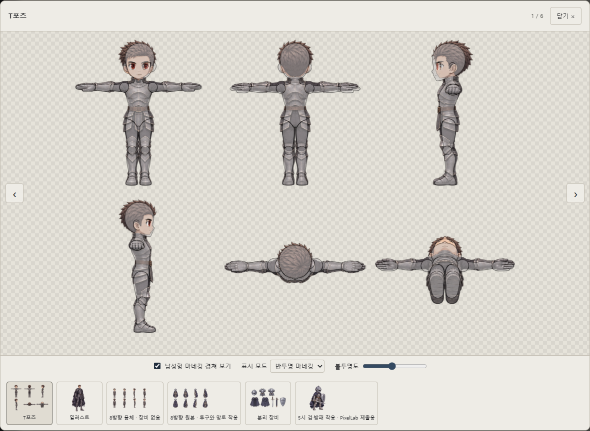

## 작업 결과

## 변경 내용

### 적용 내용

열람 잠금 범위 수정, 클릭한 결과물 비교 기준 전달, 제작 가이드 예제 연결. 프로젝트 5a31d7ab 푸시.

## 검증

Codex 미연결 브라우저에서 여성형 마네킹, 붉은 장교, 잿빛 기사의 제작 결과물을 실제 클릭해 확인. 잿빛 기사 아카이브와 제작 가이드 예제도 확인.

## 남은 사항

공개 배포 미확인.

## 작업 시간

- 제안 시간: 5분
- 실제로 완료된 시간: 약 5분, 00:14 KST 프로젝트 푸시.
- XERJ: 미사용 — 브라우저 마우스 클릭과 비교 레이어 확인
