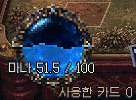

## 작업 결과

Godot 전투 HUD와 캠프 가디언 대시보드에 반영했습니다. 프로젝트 main에 5be287d0을 푸시했습니다.

## 변경 내용

### 적용 내용

마나 구체 크기를 108×108에서 88×88로 줄이고 위치를 정수 좌표에 배치했습니다. Godot 셰이더에 UV 격자 스냅과 계단형 수면 마스크를 추가하고 파동·기포 시간을 12단계/초로 샘플링합니다. 원본 구체 텍스처를 보존하며 실시간 렌더 경로에서 픽셀 처리합니다.

## 검증

Godot 4.7.2 분리 데스크톱에서 수면과 외곽의 계단 형태 및 마나 회복·드로우 소모를 확인했습니다. GIF 16프레임이 서로 달랐습니다. Chrome 헤드리스에서 변경된 대시보드의 전투 및 화면과 조작 캡처를 확인했습니다. 빌드 4.21초, 초기 HTML +238바이트, 지연 로드 캡처 참조 용량 −982,905바이트. 대상 섹션 캡처 2개와 5개입니다. 

## 남은 사항

게임 패키지·공개 Pages 배포와 모바일 재생은 미확인입니다. Sprite Fusion 정적 이미지 변환 도구는 미사용이며 Godot에서 픽셀 격자를 실시간 적용했습니다.

## 작업 시간

- 제안 시간: 6분
- 실제로 완료된 시간: 2026-11-23 00:19~00:22 KST, 약 3분. 구현·Godot 검수·대시보드 표시·프로젝트 푸시 기준.
- XERJ: 미사용 — Godot 엔진 렌더와 Chrome 헤드리스 검증.
