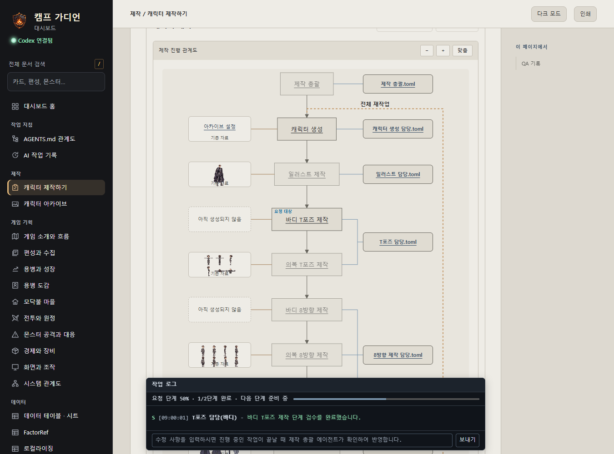
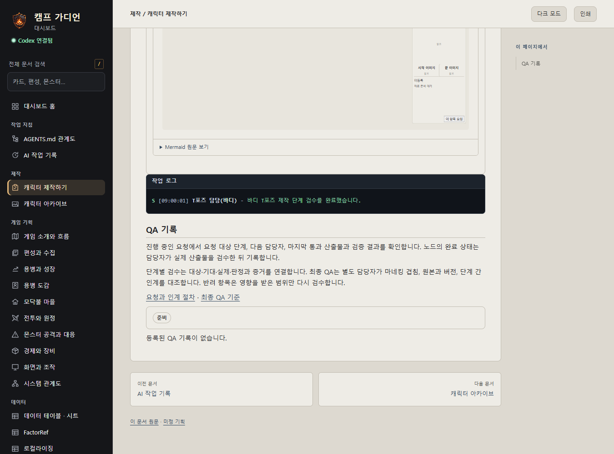

## 작업 결과

## 변경 내용

### 적용 내용

아직 대기 중인 요청이나 끝난 요청은 진행률을 숨깁니다. 실행 중 분모는 요청 단계 수이며, 분자는 이번 요청 시작 이후 검수 완료로 등록된 대상 단계 수입니다. 프로젝트 main 6e77ae43 푸시.

## 검증

브라우저에서 대기 전·접수 대기·실행 중·완료를 예시 데이터로 순서대로 재현했습니다. 이전 완료와 요청 밖 단계가 존재해도 이번 요청의 진행률은 1/2였고 완료 시 QA 위에 로그가 돌아왔습니다. 11월 23일 00:36 KST 캡처. 빌드 2.67초, HTML 3,556,268B, 패널 1개 재사용. 캡처 PNG 합계 153,079B.

## 남은 사항

백그라운드 제작 실실행과 공개 배포는 미확인입니다. 중앙 지침은 로컬 2026-11-22-004까지 확인했고 원격 최신은 미확인입니다.

## 작업 시간

- 제안 시간: 11월 23일 00:33 KST 시작, 약 5분.
- 실제로 완료된 시간: 11월 23일 00:36:50 KST 구현·검증·프로젝트 푸시 완료, 약 3분.
- XERJ: 미사용 — rg, Node, Chrome 사용.
