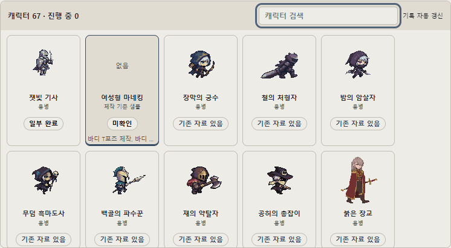

## 작업 결과

슬롯의 이름이나 썸네일을 누르면 캐릭터 제작 상세를 선택합니다.

## 변경 내용

### 적용 내용

아카이브에 등록된 걷기 클립과 공용 재생 코드를 사용합니다. 스크롤 영역에 보이는 썸네일만 재생하며 슬롯에 기존 상태와 요청 버튼을 배치했습니다. 프로젝트 main f07aad81 푸시.

## 검증

Chrome에서 67개 슬롯 중 걷기 46개와 없음 21개, 실제 이미지 로드와 프레임 변경, 슬롯 상세 전환, 검색과 빈 결과를 확인했습니다. 아카이브의 기존 목록 재생도 확인했습니다. 11월 23일 00:43 KST 캡처. 빌드 2.39초, 초기 HTML 3,561,634B, 별도 썸네일 원본 추가 없음, GIF 124,750B.

## 남은 사항

백그라운드 제작 실행과 공개 배포 미확인. 중앙 지침은 로컬 2026-11-22-004까지 확인했고 원격 최신은 미확인입니다.

## 작업 시간

- 제안 시간: 11월 23일 00:41 KST 시작, 약 7분.
- 실제로 완료된 시간: 11월 23일 00:44:19 KST 구현·게시판 검증·프로젝트 푸시 완료, 약 3분.
- XERJ: 미사용 — rg, Node, Chrome 사용.
