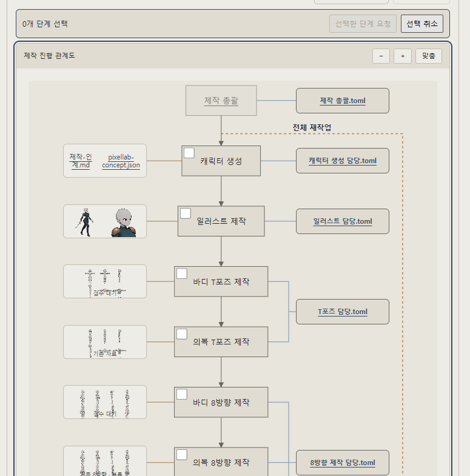

## 작업 결과

## 변경 내용

### 적용 내용

도형 클릭을 체크박스 선택으로 연결하고 선택 중 링크 클릭은 막습니다. 일반 모드의 문서 링크와 체크박스 키보드 선택을 유지합니다. 프로젝트 main 8b7953d9 푸시.

## 검증

Chrome에서 도형 이름과 우하단 여백 클릭, 체크박스의 클릭 및 스페이스 키, 선택한 단계만 접수, 선택 중 페이지 이동·팝업 없음과 일반 모드에서 문서 링크 열기를 확인했습니다. 11월 23일 00:58 KST 캡처. 빌드 3.13초, 초기 HTML 3,565,047B, 새 UI 요소 없음, 검증 GIF 73,557B.

## 남은 사항

공개 배포와 중앙 지침 원격 최신 미확인. 로컬 지침 2026-11-22-004 확인.

## 작업 시간

- 제안 시간: 11월 23일 00:57 KST 시작, 약 4분.
- 실제로 완료된 시간: 11월 23일 00:58:31 KST 구현·검증·프로젝트 푸시 완료, 약 1분.
- XERJ: 미사용 — rg, Node, Chrome 사용.
