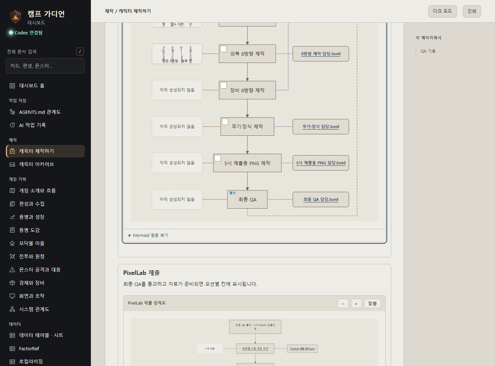

## 작업 결과

## 변경 내용

### 적용 내용

최종 QA는 선택 모드에 필수로 표시되고 확인 및 접수 단계 목록에 포함됩니다. 부분 요청의 QA는 선택한 단계와 인계를 검수하며 결과에 범위를 기록합니다. PixelLab은 전체 QA 통과를 요구합니다. 프로젝트 main 2f8e127e 푸시.

## 검증

Chrome에서 제작 단계 9개에만 체크박스 표시, QA 단독 요청 차단, 확인과 저장 목록에 QA 포함을 검증했습니다. 격리 데이터로 선택 단계 등록 전 QA 시작 차단, 부분 QA 기록과 요청 종료, PixelLab 자격 차단을 확인했습니다. 11월 23일 01:02 KST 캡처. 빌드 3.16초, 초기 HTML 3,565,489B, 검증 GIF 395,377B.

## 남은 사항

실제 제작 실행 및 PixelLab 외부 호출과 공개 배포는 미확인입니다. 중앙 지침은 로컬 2026-11-22-004까지 확인했고 원격 최신은 미확인입니다.

## 작업 시간

- 제안 시간: 11월 23일 00:59 KST 시작, 약 5분.
- 실제로 완료된 시간: 11월 23일 01:02:56 KST 구현·검증·프로젝트 푸시 완료, 약 3분 30초.
- XERJ: 미사용 — rg, Node, Chrome 사용.
