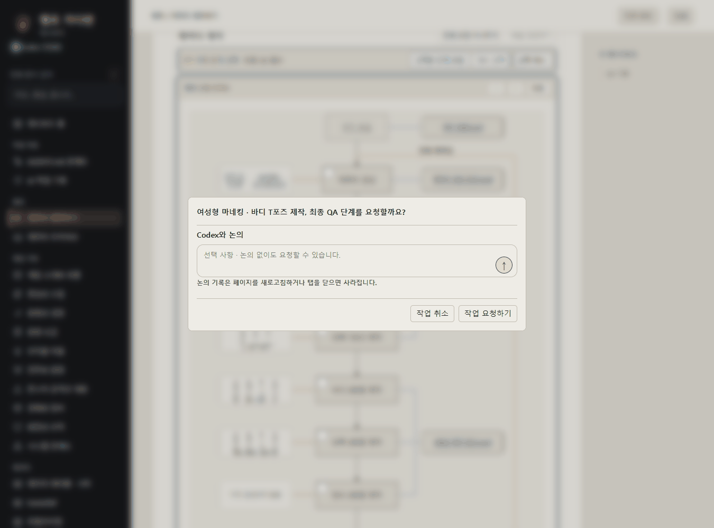

## 작업 결과

## 변경 내용

### 적용 내용

작업 요청 버튼과 논의 전송 동작을 분리하고 논의는 선택 사항으로 표기했습니다. 처리 중에 확인창에 상태가 표시되며, 접수 후 실행 오류는 확인창에서 확인하고 동일 요청으로 다시 시도할 수 있습니다. 작업자 중단 이유는 제작 화면에 표시합니다. 프로젝트 main 4908da0d 푸시.

## 검증

Chrome에서 빈 논의로 실제 접수 함수를 사용했고 실행 시작·중단 응답은 검증용으로 대체했습니다. 처리 표시, 실패 사유, 같은 접수 건의 재시도와 성공을 확인했습니다. 11월 23일 01:06 KST 캡처. 대시보드 빌드 3.21초, 초기 HTML 3,565,489B, 증거 GIF 838,941B.

## 남은 사항

사용자가 시도한 당시의 실행 결과와 실제 백그라운드 제작 실행, 공개 배포 미확인. 중앙 지침은 로컬 2026-11-22-004까지 확인했고 원격 최신은 미확인.

## 작업 시간

- 제안 시간: 11월 23일 01:03 KST 시작, 약 5분.
- 실제로 완료된 시간: 11월 23일 01:06:21 KST 구현·검증·프로젝트 푸시 완료, 약 2분 30초.
- XERJ: 미사용 — rg, Node, Chrome 사용.
