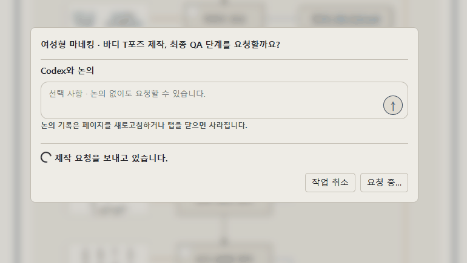

## 작업 결과

## 변경 내용

### 적용 내용

전송 중 로딩과 제작 버튼 잠금을 적용했습니다. 접수 이후에는 서버에 저장된 요청 상태를 표시하며 해당 캐릭터의 새 요청 버튼을 잠급니다. 응답이 뒤늦게 도착한 이전 조회값이 최신 요청 상태를 덮는 것을 막습니다. 프로젝트 main 87ecbe07 푸시.

## 검증

Chrome에서 실제 접수 함수를 쓰고 실행 응답과 종료 사유는 검증용으로 대체했습니다. 전송 중 전체 요청 버튼 잠금, 접수 문구, 중복 없는 재시도, 새로고침 후 실행 표시와 잠금 유지, 중단 시 잠금 해제를 확인했습니다. 11월 23일 01:09 KST 캡처. 빌드 3.11초, 초기 HTML 3,565,489B, GIF 116,374B.

## 남은 사항

사용자가 누른 요청의 접수 여부, 실제 백그라운드 제작 실행 및 공개 배포 미확인. 중앙 지침은 로컬 2026-11-22-004까지 확인했고 원격 최신은 미확인입니다.

## 작업 시간

- 제안 시간: 11월 23일 01:07 KST 시작, 약 5분.
- 실제로 완료된 시간: 11월 23일 01:09:37 KST 구현·검증·프로젝트 푸시 완료, 약 2분 30초.
- XERJ: 미사용 — rg, Node, Chrome 사용.
