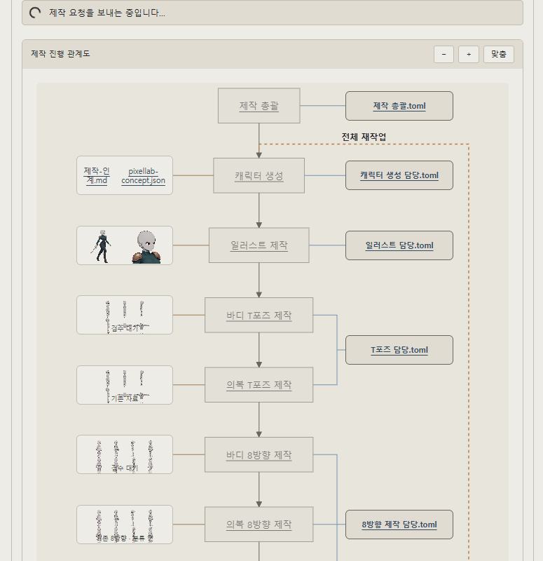

## 작업 결과

## 변경 내용

### 적용 내용

요청 전송과 잠금을 캐릭터별로 적용합니다. 접수와 실패를 해당 제작 화면에 표시하고 접수된 건은 다시 실행할 수 있습니다. 프로젝트 main 370d6db2 푸시.

## 검증

Chrome에서 전송 응답을 지연시켜 팝업 즉시 닫기, 대상만 잠금, 다른 캐릭터 요청, 기존 화면 유지와 오류 표시를 확인했습니다. 실제 접수 함수와 검증용 실행 응답을 사용했습니다. HTML 크기 변화 없이 대시보드 빌드를 확인했습니다.

## 남은 사항

실제 제작 워커 실행과 공개 배포 미확인.

## 작업 시간

- 제안 시간: 5분.
- 실제로 완료된 시간: 11월 23일 10:27 KST 최종 검증 및 프로젝트 푸시 완료. 세션 중단 포함 경과 약 9시간 12분.
- XERJ: 미사용 — rg, Node, Chrome 사용.
