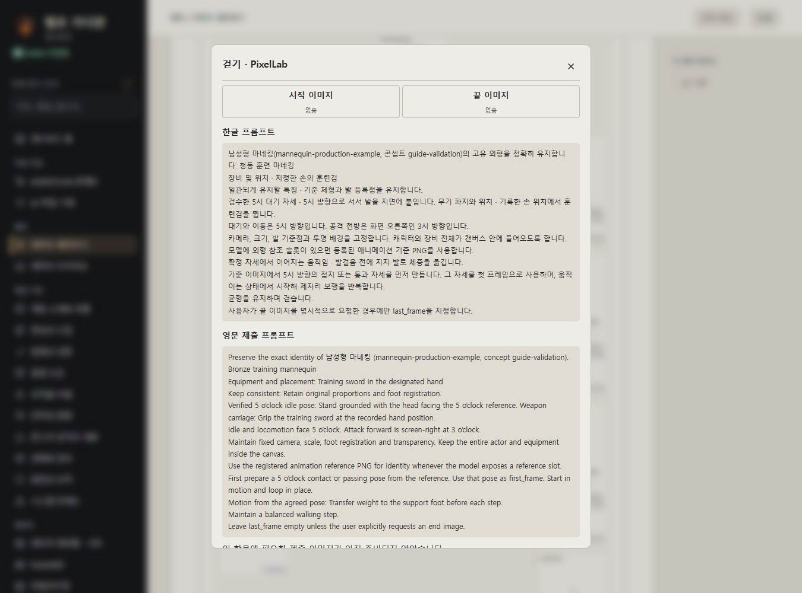

## 작업 결과

## 변경 내용

### 적용 내용

캐릭터·5시 PNG·최종 QA 지침을 수정했습니다. 제출 단계가 등록한 한영 자세와 무기 파지 및 동작 전환을 최종 QA에서 PNG 및 콘셉트 버전과 대조하고, 통과 시 기준 도트·준비 자세·모션 프롬프트에 반영합니다. 기본 공격 3도 구성한 경우 표시됩니다. 프로젝트 main 53527523 푸시.

## 검증

격리 작업공간에서 실제 --qa CLI로 초안 생성을 확인했습니다. 기존 검수용 PNG와 검증용 콘셉트를 사용해 한영 걷기, 공격 3, 변경 해시, PNG 불일치 차단, 기존 자료 호환성을 확인했습니다. Chrome에서 한영 초안 표시 및 제출 제한을 확인했습니다. 11월 23일 10:36 KST 캡처. 대시보드 빌드 2.57초.

## 남은 사항

이 요청은 제작 흐름 수정입니다. 새 캐릭터 이미지 제작과 PixelLab 외부 호출은 미실행입니다. 공개 배포 및 중앙 지침 원격 최신 미확인.

## 작업 시간

- 제안 시간: 11월 23일 10:32 KST 시작, 약 8분.
- 실제로 완료된 시간: 11월 23일 10:36:57 KST 구현·검증·프로젝트 푸시 완료, 약 4분 30초.
- XERJ: 미사용 — rg, Node, Chrome 사용.
