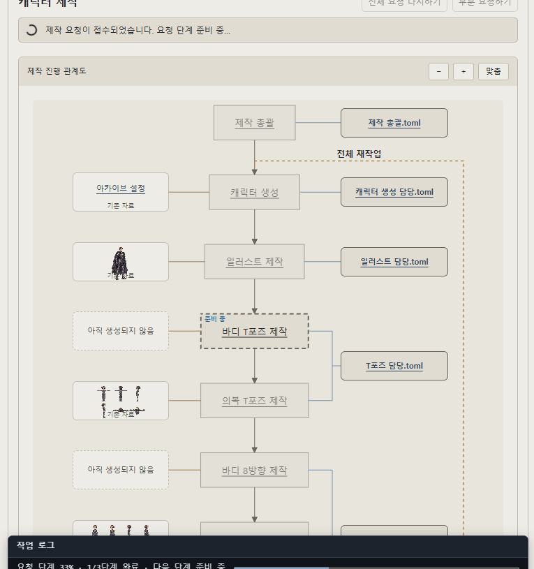

## 작업 결과

## 변경 내용

### 적용 내용

접수 후 준비 중에도 상태줄에서 로딩을 유지하고 관계도의 다음 요청 단계에 움직이는 점선과 준비 중 표시를 적용했습니다. 실제 단계 시작 시 실행 연출로 전환합니다. 프로젝트 main deb20051 푸시.

## 검증

Chrome에서 부분 요청의 준비, 실행, 완료 상태를 검증 데이터로 순서대로 확인했습니다. 11월 23일 10:43 KST 캡처. 대시보드 빌드 3.22초, 신규 UI 노드 없음.

## 남은 사항

공개 배포와 중앙 지침 원격 최신은 미확인입니다.

## 작업 시간

- 제안 시간: 11월 23일 10:42 KST 시작, 약 4분.
- 실제로 완료된 시간: 11월 23일 10:43:38 KST 구현·검증·프로젝트 푸시 완료, 약 1분 30초.
- XERJ: 미사용 — rg, Node, Chrome 사용.
