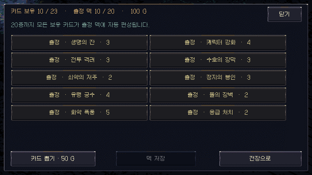

## 작업 결과

Godot 마을 덱 구성과 캠프 가디언 대시보드에 추가했습니다. 프로젝트 main에 935ddb9e를 푸시했습니다.

## 변경 내용

### 적용 내용

넷마블 세븐나이츠 리버스 공식 가이드의 카드 등장과 컴투스 서머너즈 워 공식 공지의 소환 마법진을 참고했습니다. 캠프 가디언의 픽셀 프레임과 아이콘으로 봉인 문양, 상승, 회전, 공개를 연출했습니다. 획득과 차감 저장 후 결과 화면을 열고 건너뛰기 및 덱 복귀를 연결했습니다.

## 검증

Godot 4.7.2에서 연출 완료와 결과·덱 복귀를 확인했습니다. 같은 호출을 연출 중 반복해도 겹쳐 결제되지 않았습니다. 두 번째 뽑기는 건너뛰기를 실행했고 저장을 재로드해 골드 0과 신규 카드 두 장을 확인했습니다. 실제 캡처 GIF 19프레임 중 14개가 서로 달랐습니다. 대시보드 빌드 2.56초, 초기 HTML +2,496바이트, 지연 로드 GIF +504,328바이트, 마을 섹션 실제 안내 캡처 4개. Chrome에서 새 GIF의 본문 표시 및 확대 모달 재생을 확인했습니다. 

## 남은 사항

모바일 UI와 게임 패키지·공개 Pages 배포는 미확인입니다.

## 작업 시간

- 제안 시간: 10분
- 실제로 완료된 시간: 2026-11-23 10:40~10:45 KST, 약 4분 10초. 조사·구현·실행·대시보드 확대 검수·프로젝트 푸시 기준.
- XERJ: 미사용 — 공식 출처 확인, Godot 실제 렌더와 Chrome 헤드리스 확인.
