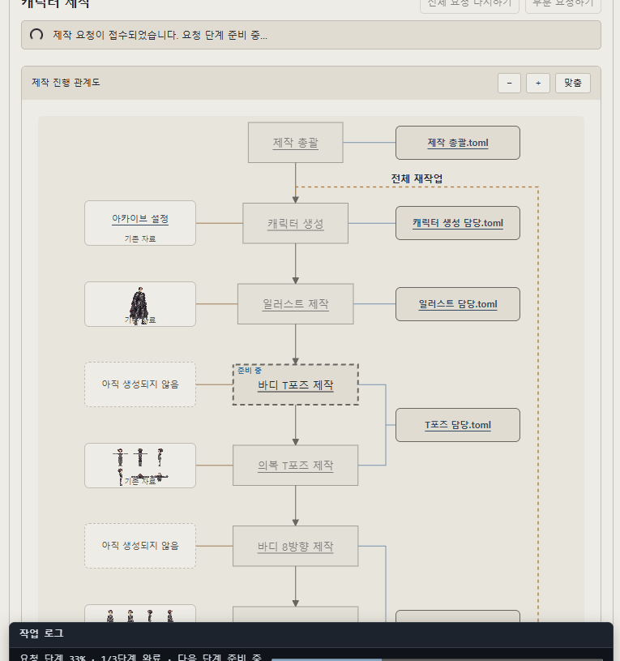

## 작업 결과

## 변경 내용

### 적용 내용

제작 상태 표시의 동작 감소 분기를 제거하고 중앙 프로젝트 지침에 기록했습니다. 프로젝트 main 4e4804f 푸시.

## 검증

Chrome에서 prefers-reduced-motion: reduce를 활성화하고 스피너와 다음 단계 점선의 애니메이션, 단계 실행 전환과 완료 시 정리를 확인했습니다. 대시보드 빌드 통과. 초기 HTML 3,577,461B, 증거 GIF 64,375B.

## 남은 사항

사용자 Chrome 현장 및 공개 배포 미확인.

## 작업 시간

- 제안 시간: 약 5분.
- 실제로 완료된 시간: 11월 23일 11:02:51 KST 프로젝트 푸시 완료, 약 1분.
- XERJ: 미사용 — rg, Node, Chrome 사용.
