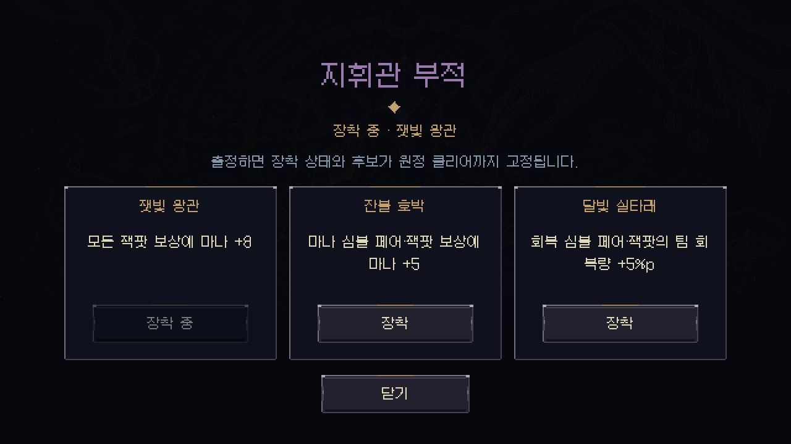
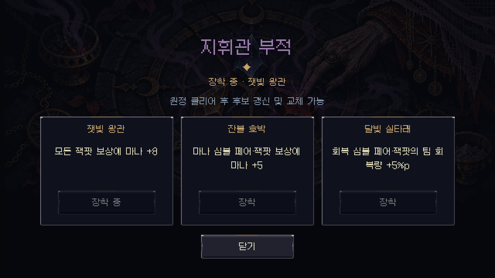
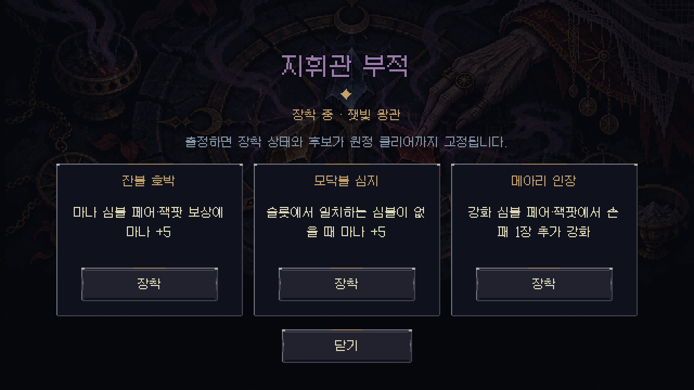
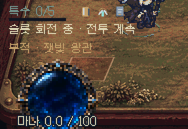

## 작업 결과

모닥불 마을의 지휘관 부적 메뉴에서 세 후보 중 하나를 장착할 수 있습니다. 부적 다섯 종이 플레이어의 실시간 슬롯 보상을 각각 바꿉니다. 프로젝트 커밋 a4b910c5를 origin/main에 푸시했습니다.

## 변경 내용

### 적용 내용

출정 시 지휘관 저장에 후보와 교체 잠금을 함께 기록합니다. 구역 이동, 패배, 중도 귀환, 게임 재시작 뒤에도 유지됩니다. 10구역 승리 정산은 잠금을 해제하고 후보 세 개를 갱신합니다. 기존 부적은 교체할 때까지 남습니다.

## 검증

Godot 4.7.2에서 장착, 출정, 저장 재로딩, 중도 귀환, 잠금 상태의 교체 거부, 최종 구역 승리 판정 및 갱신 저장을 확인했습니다. 지정한 잭팟에서 기본 마나 5에 부적 마나 8이 추가됐습니다. 대시보드 빌드 2.82초, HTML 9,025바이트 및 신규 미디어 814,544바이트 증가. 부적 표 5개 행과 이미지 확대를 확인했습니다.

## 남은 사항

10개 구역을 처음부터 끝까지 플레이하는 밸런스 검증과 공개 페이지에서의 재생은 미확인입니다.

## 작업 시간

- 제안 시간: 10분
- 실제로 완료된 시간: 기능·증거·프로젝트 푸시 약 8분. 2026-11-23 11:31 KST 기준.
- XERJ: 미사용 — rg로 Godot 진입점과 저장·정산 흐름을 확인했습니다.
