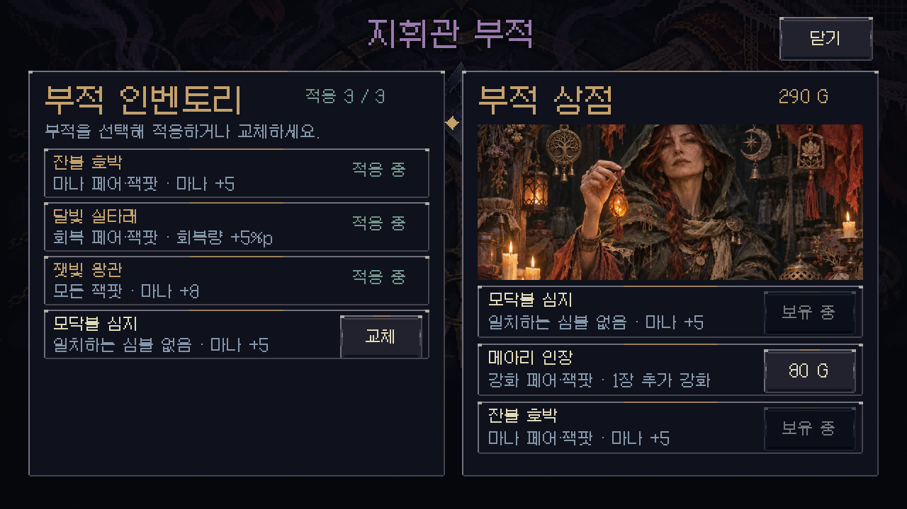
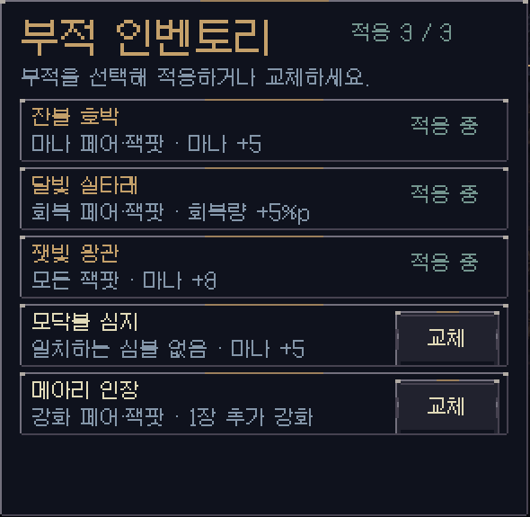

## 작업 결과

인벤토리와 상점을 같은 화면에 배치했습니다. 적용 중인 부적을 상단에 모으고 나머지를 교체 후보로 보관합니다. 프로젝트 원격 main에 a2b69a2a를 반영했습니다.

## 변경 내용

### 적용 내용

지휘관별 보유 부적을 저장하고 동시에 3개까지 적용합니다. 슬롯이 찼으면 교체 대상 부적을 고릅니다. 첫 부적은 무료이며 이후 50~100 G입니다. 출정 후 교체 잠금은 10구역 클리어 정산에서 풀리며 상점 진열도 이때 갱신합니다. 기본 ImageGen으로 등불 아래 부적을 내미는 후드 차림 상인을 제작해 상점 화면에 반영했습니다.

## 검증

Godot 4.7.2 실제 화면에서 구매 및 골드 차감, 부적 3개 적용, 교체 취소와 확정, 기존 1개 장착 저장의 이관, 슬롯 효과 합산, 중도 귀환 잠금과 최종 구역 정산의 잠금 해제 및 진열 갱신을 확인했습니다. 대시보드 빌드 2.85초, HTML 1,928바이트 증가, 대시보드 신규 증거 329,387바이트. 부적 표 5행과 이미지 확대를 확인했습니다.

## 남은 사항

실제 전체 원정 플레이 밸런스와 공개 페이지의 이미지 재생은 미확인입니다.

## 작업 시간

- 제안 시간: 약 10분
- 실제로 완료된 시간: 기능·캡처·프로젝트 푸시 약 6분. 2026-11-23 11:39 KST 기준.
- XERJ: 미사용 — rg로 지휘관 저장·부적 보상·모달 진입점을 확인했습니다.
