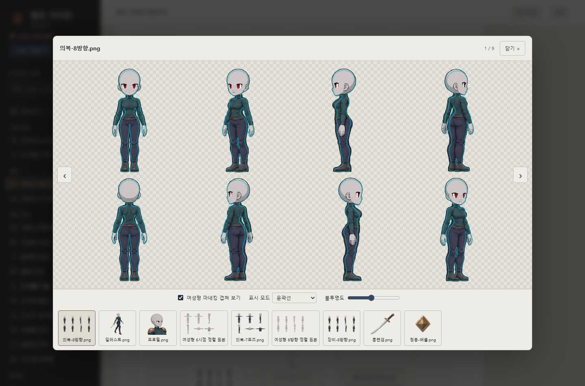

## 작업 결과

여성형 의복 8방향 확대 화면에서 윤곽선을 표시했습니다.

## 변경 내용

### 적용 내용

제작 현황의 8방향에 체형별 마네킹 원본과 윤곽선을 연결하고, 제작 가이드의 원본과 단계별 예제에 같은 비교 정보를 적용했습니다. 프로젝트 커밋 430e885e를 origin/main에 푸시했습니다.

## 검증

대시보드 빌드 약 2.7초. HTML 3,605,007바이트(+11,518), 추가 대시보드 이미지 0개. 로컬 대시보드 파일을 헤드리스 Chrome에 제공해 제작 가이드 2건 및 여성형 제작 현황 3건에서 두 모드의 실제 표시가 다름을 확인했습니다.

## 남은 사항

공개 페이지 배포 및 모바일 표시 미확인.

## 작업 시간

- 제안 시간: 약 8분
- 실제로 완료된 시간: 2026-11-23 11:38~11:42 KST, 프로젝트 푸시까지 약 4분.
- XERJ: 미사용 — 프로젝트 파일과 브라우저에서 직접 확인
