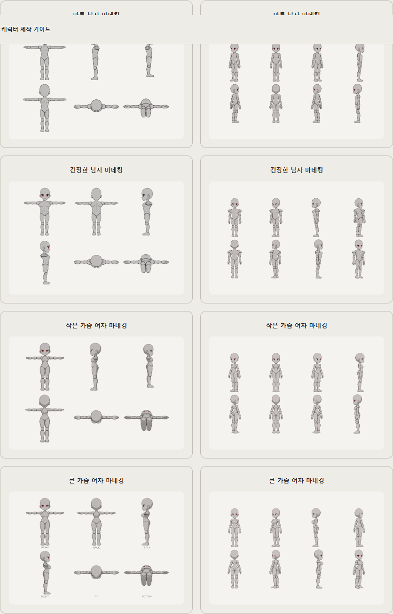
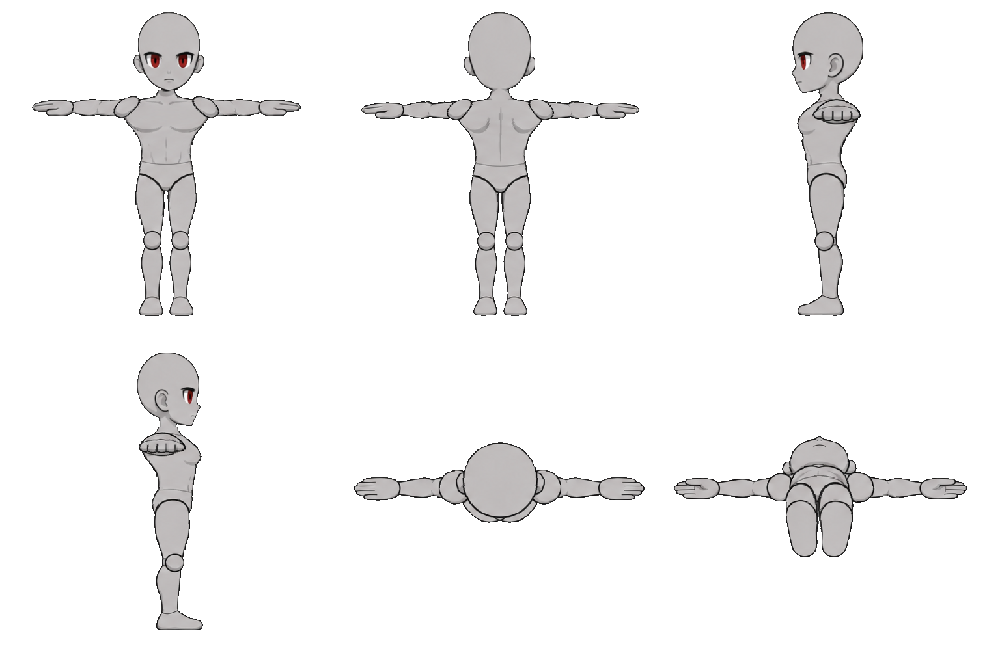
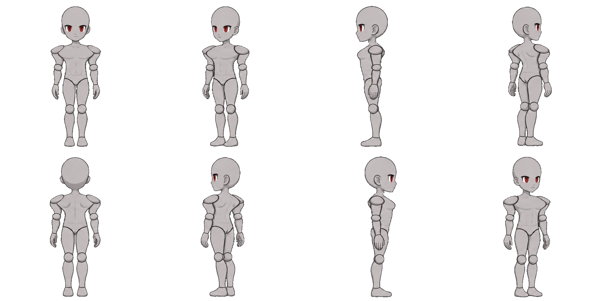
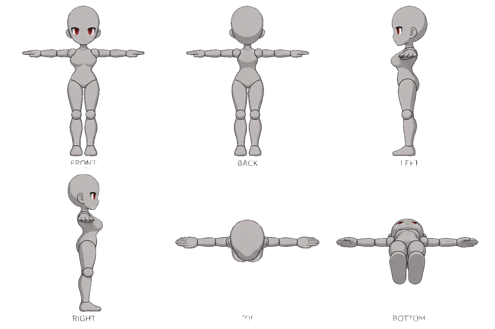
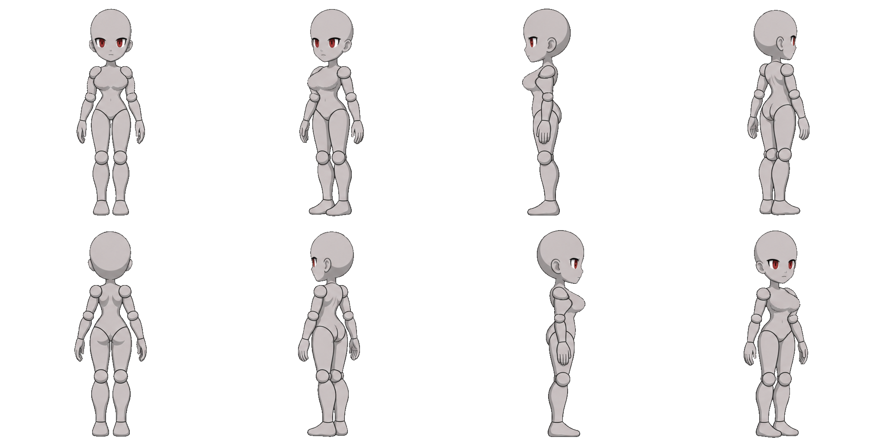

## 작업 결과

캠프 가디언 대시보드 제작 가이드와 캐릭터 아카이브에 네 체형이 표시됩니다.

## 변경 내용

### 적용 내용

기존 마네킹 ID·원본 경로 유지. 신규 체형은 등록 원본의 윤곽을 국소 보정하고 시점별 원본과 SHA-256을 기록했습니다. 새 시트와 청록 윤곽을 연결했습니다.

## 검증

로컬 대시보드 빌드 및 Chromium에서 네 카드, 원본 여덟 장, 윤곽 겹침과 제작 가이드 표시를 확인했습니다. 게임 실행 및 원격 페이지 표시 미확인.

## 남은 사항

원격 대시보드 배포 및 공개 접근은 미확인입니다.

## 작업 시간

- 제안 시간: 10분
- 실제로 완료된 시간: 약 7분, 11:42 시작, 11:49 KST 검수 완료
- XERJ: 미사용 — 코드 검색 근거가 제공되지 않았습니다.
