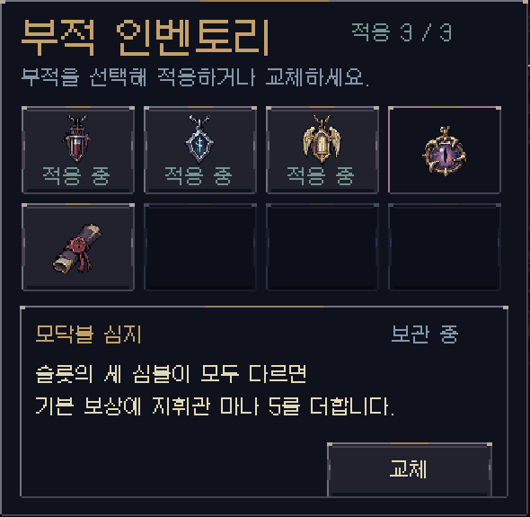

## 작업 결과

기존 게임 아이템 아이콘을 활용한 그리드에서 부적을 선택하면 하단에 이름, 보관·적용 상태, 상세 효과와 적용·교체 버튼이 표시됩니다. 프로젝트 main에 cecfa859를 푸시했습니다.

## 변경 내용

### 적용 내용

적용 중인 부적에 슬롯 라벨을 표시합니다. 각 아이콘의 툴팁에는 부적 이름, 적용 상태와 발동 조건을 표시합니다. 슬롯 3개가 찼으면 하단 교체를 누른 뒤 적용 슬롯을 선택합니다.

## 검증

Godot 4.7.2에서 실제 뷰포트 호버와 슬롯 선택, 구매·적용, 교체 취소 및 확정, 출정 후 잠금과 클리어 정산을 확인했습니다. 대시보드 빌드 3.08초, 커밋 대상 HTML 1,374바이트 증가, 증거 미디어 704,407바이트, 부적 표 5행. 증거 3개와 이미지 확대를 브라우저에서 확인했습니다.

## 남은 사항

공개 페이지의 이미지 표시와 재생 미확인.

## 작업 시간

- 제안 시간: 8분
- 실제로 완료된 시간: 구현·검증·프로젝트 푸시 약 6분. 2026-11-23 12:15 KST.
- XERJ: 미사용 — rg로 기존 인벤토리와 아이템 아이콘을 확인했습니다.
