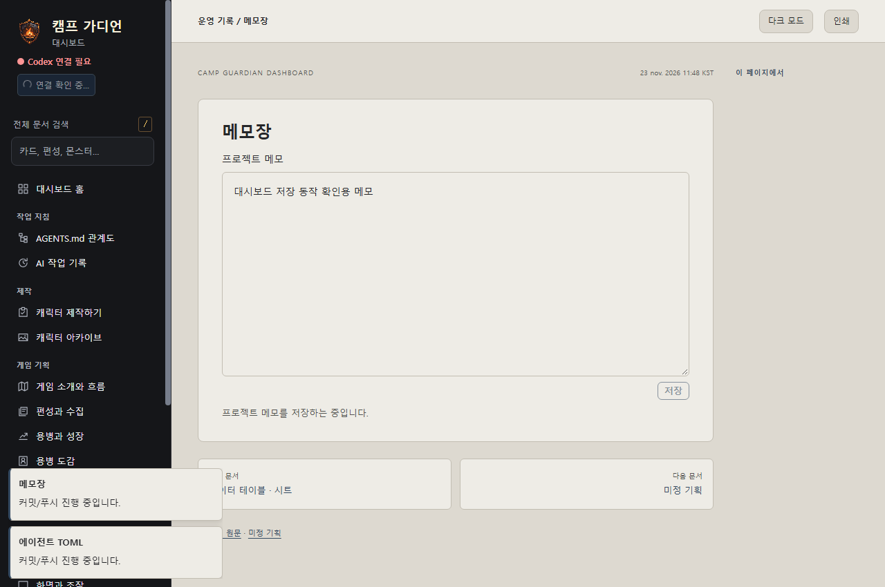

## 작업 결과

메모장, 에이전트 TOML, PixelLab 모션 설정을 저장하면 대상 파일만 개별 커밋하고 원격 main에 푸시합니다. 공통 저장과 알림 사용 규칙을 프로젝트 지침에 반영했습니다. 프로젝트 커밋은 9a6b3be8입니다.

## 변경 내용

### 적용 내용

저장 요청을 순차 처리합니다. 먼저 편집한 원본과 최신 파일을 대조하고, 무관한 파일이나 기존 스테이지 변경을 보존합니다. 좌하단 알림은 저장마다 진행·성공·푸시 대기를 표시합니다. 푸시 실패 시 로컬 커밋을 보존하고 재시도를 제공합니다. 테마와 로컬 제작 큐는 기기별 운영 상태입니다.

## 검증

헤드리스 Chrome 및 격리된 Git 원격에서 메모장과 TOML의 동시 저장, 토스트 두 건, 개별 커밋, 원격 main 커밋, 기존 스테이지 변경 보존을 확인했습니다. PixelLab 설정 저장 후 원격 실패와 재시도, 오래된 원본 충돌 거부를 재현했습니다. 대시보드 생성은 약 2.2초였으며 초기 HTML은 3,617,128에서 3,619,709바이트, 검색 데이터는 229,875에서 229,961바이트로 늘었습니다. 페이지 19개를 유지했습니다.

## 남은 사항

공개 사이트에는 저장 서버가 없으므로 프로젝트 저장은 로컬 대시보드에서 사용합니다. 렌더링 목록 크기, 전체 공개 패키지 증가량과 공개 배포는 미확인입니다.

## 작업 시간

- 제안 시간: 10분
- 실제로 완료된 시간: 2026-11-23 12:12부터 12:20까지 약 8분, 한국시간 KST
- XERJ: 미사용 — Git, Node, Chrome DevTools로 코드와 실제 동작을 확인했습니다.
