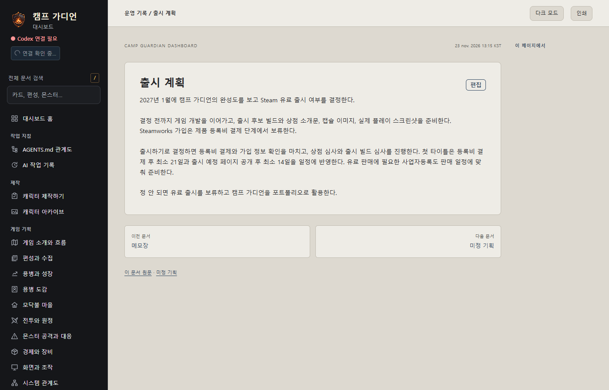
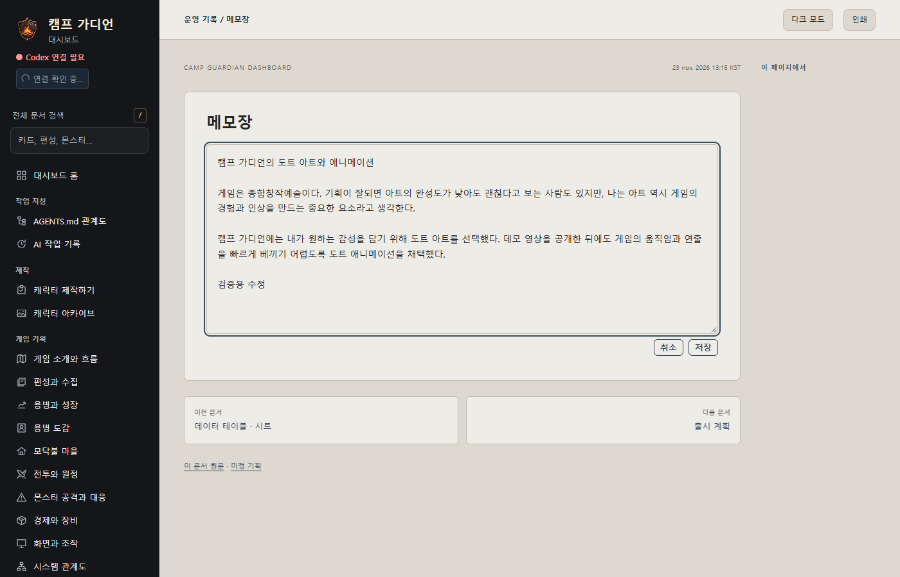

## 작업 결과

프로젝트 main에 d1236164를 푸시했습니다.

## 변경 내용

### 적용 내용

2027년 1월 유료 출시 판단과 포트폴리오 이용 계획을 등록했습니다. 기존 메모장은 읽기 화면으로 열리며 편집 버튼에서 저장과 취소를 사용할 수 있습니다.

## 검증

헤드리스 Chrome으로 읽기·편집·취소와 저장 응답 처리를 확인했습니다. 임시 Git 저장소에서 양쪽 저장 API의 파일 반영, 단일 문서 커밋, 원격 푸시를 확인했습니다. 대시보드 빌드는 약 3.2초였고 커밋 기준 초기 HTML은 2,923바이트 증가했습니다.

## 남은 사항

실제 운영 서버의 저장 및 공개 페이지 확인은 미실행입니다.

## 작업 시간

- 제안 시간: 10분
- 실제로 완료된 시간: 약 4분 22초, 2026-11-23 13:18:06 KST
- XERJ: 미사용 — 코드 검색 근거가 제공되지 않았습니다.
