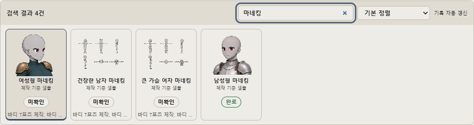
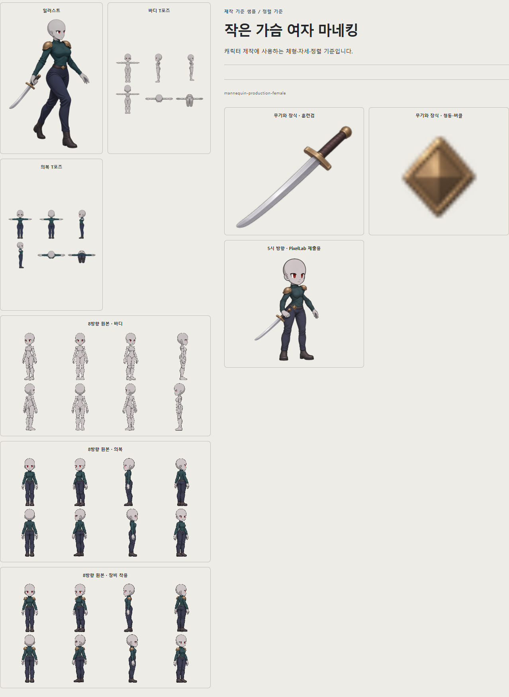
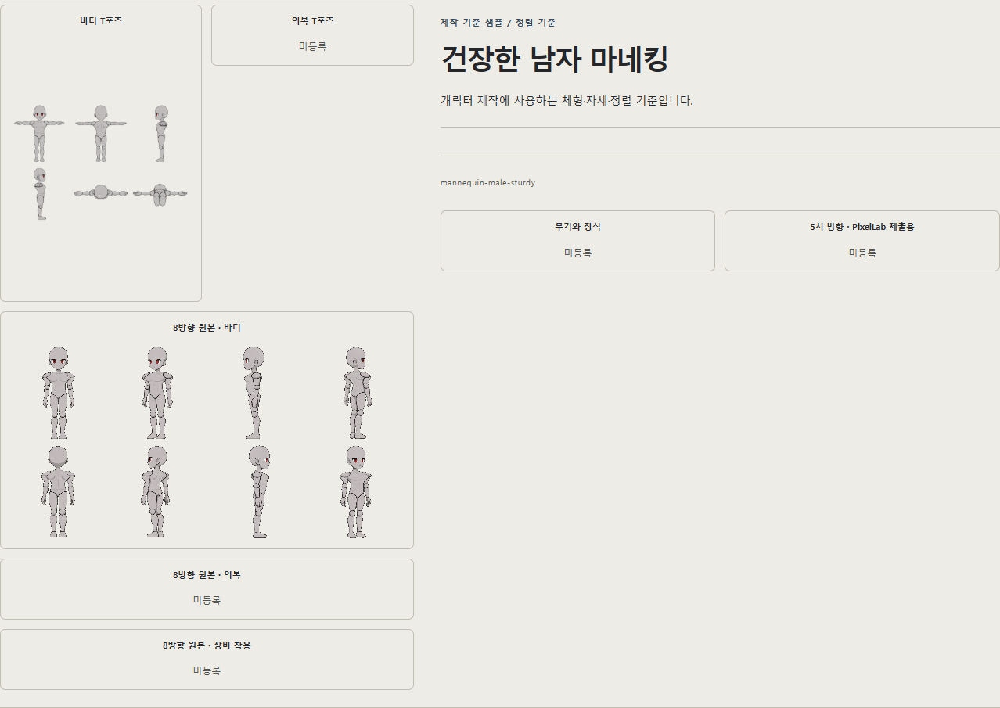

## 작업 결과

제작 목록에서 마네킹 네 종을 검색할 수 있습니다. 기존 두 종의 등록 산출물과 새 두 종의 바디 원본을 아카이브에서 열 수 있습니다.

## 변경 내용

### 적용 내용

건장한 남자 및 큰 가슴 여자 마네킹을 작업 목록에 등록했습니다. 무기·장식과 5시 이미지 묶음을 설명 바로 아래에 배치했습니다. 새 두 종에서 의복, 장비와 제출 이미지 슬롯은 미등록으로 표시했습니다.

## 검증

로컬 HTTP 브라우저에서 마네킹 검색 4건, 카드 이미지 4장, 기존 두 종 각 9장, 새 두 종 각 2장, 붉은 장교 6장과 여성형 의복 8방향 확대를 확인했습니다. 대시보드 빌드 약 2.5초. 생성 HTML은 직전 커밋 대비 약 65KB 증가했습니다. 프로젝트 커밋 e1dde4ad를 origin/main에 푸시했습니다.

## 남은 사항

새 두 종의 의복, 장비, 제출 시안은 미등록입니다. 외부 배포·접근은 미확인입니다.

## 작업 시간

- 제안 시간: 2026-11-23 14:48 KST 시작, 예상 10분.
- 실제로 완료된 시간: 2026-11-23 14:54 KST 구현·브라우저 검증·프로젝트 푸시 완료, 약 6분.
- XERJ: 미사용 — 로컬 대시보드의 HTTP 화면을 브라우저에서 직접 확인했습니다.
