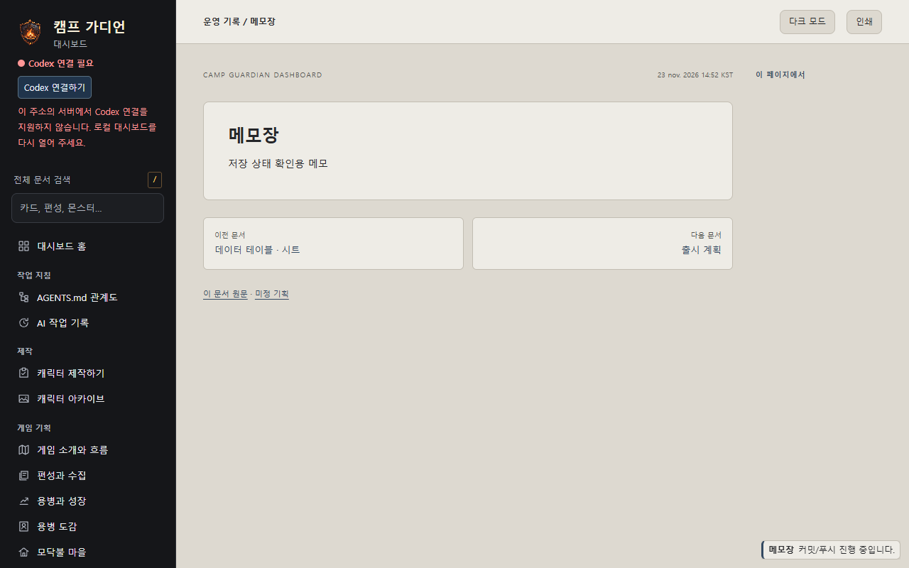

## 작업 결과

## 변경 내용

### 적용 내용

대시보드 변경 c1f82579를 origin/main에 푸시했습니다.

## 검증

브라우저에서 저장 응답을 지연시켜 읽기 전환과 우측 하단 한 줄 토스트, 완료 상태를 확인했습니다. 예시 메모와 모의 저장 응답을 사용했습니다.

## 남은 사항

실제 메모 저장 및 운영 배포 미확인.

## 작업 시간

- 제안 시간: 약 5분
- 실제로 완료된 시간: 약 1분 30초. 2026-11-23 15:02 KST 프로젝트 푸시.
- XERJ: 미사용 — 대시보드 빌드 및 브라우저 캡처
