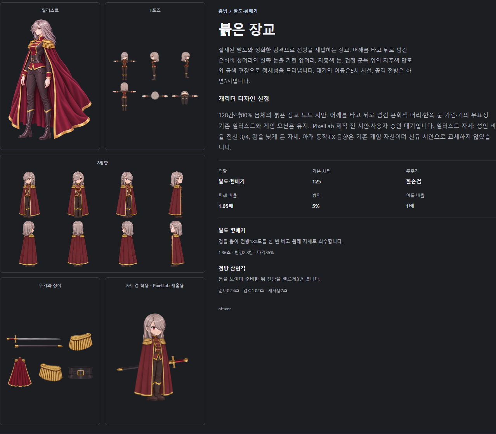
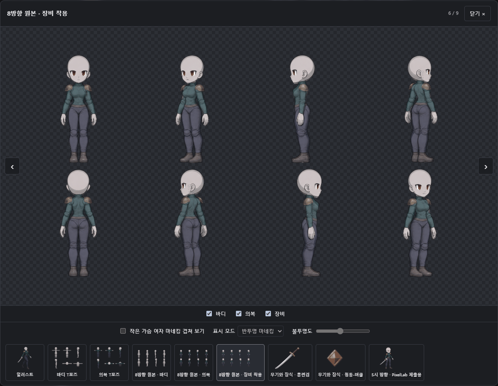
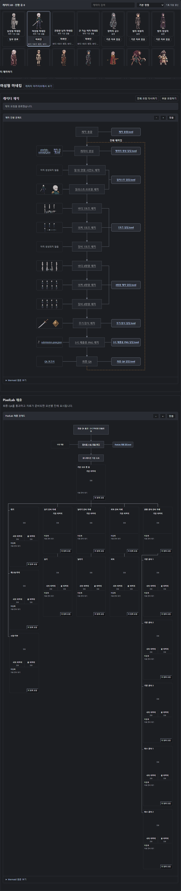

## 작업 결과

카드를 확대하면 등록된 바디·의복·장비가 기본으로 겹쳐지고 각 시트를 끌 수 있습니다. 제작하기에서 장비 T포즈 단계를 선택할 수 있습니다.

## 변경 내용

### 적용 내용

아카이브 이미지 영역에 일러스트, T포즈, 8방향, 분리 장비, 5시 제출용을 배치했습니다. 장비 T포즈는 의복 T포즈 다음으로 연결하고 담당, 단계 상태 등록, QA 및 인계 문서를 갱신했습니다.

## 검증

로컬 HTTP 대시보드에서 붉은 장교 장비 8방향 대표, 여성형 마네킹 T포즈 두 레이어 및 8방향 세 레이어 기본 체크와 장비 체크 해제 시 캔버스 픽셀 변화, 새 마네킹의 빈 슬롯 미표시 및 제작 관계도 장비 T포즈 노드를 확인했습니다. 빌드 약 2.4초, HTML 약 1.5KB 감소. 프로젝트 fff91f55를 origin/main에 푸시했습니다.

## 남은 사항

장비 T포즈 실제 제작과 등록은 이번 변경 범위에 포함하지 않았습니다. 공개 배포·접근 미확인.

## 작업 시간

- 제안 시간: 2026-11-23 15:29 KST 시작, 예상 10분.
- 실제로 완료된 시간: 2026-11-23 15:36 KST 구현·브라우저 확인·프로젝트 푸시 완료, 약 7분.
- XERJ: 미사용 — 로컬 대시보드 실제 브라우저 확인 및 모달 상태 변경 GIF.
