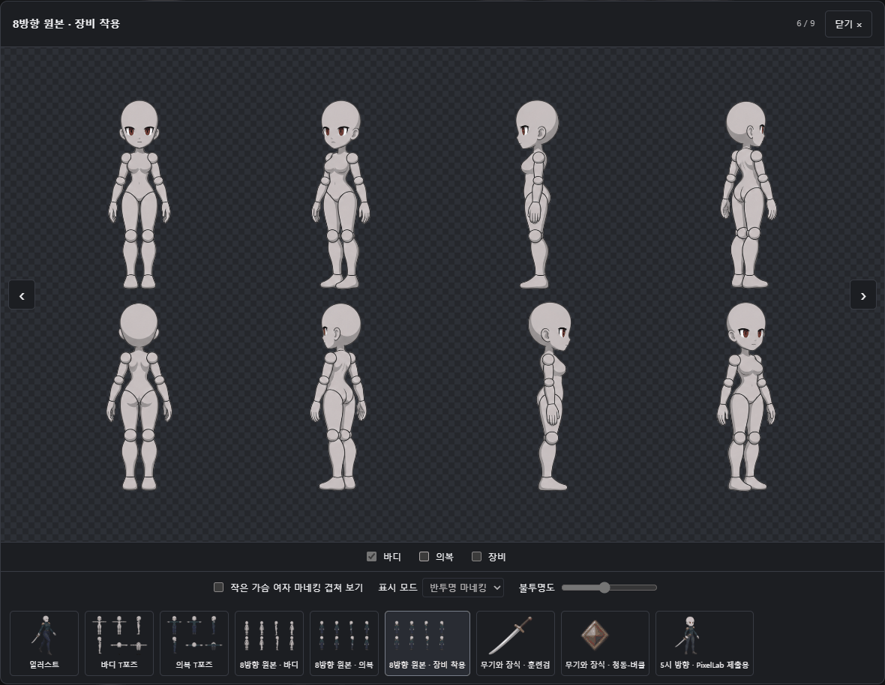

## 작업 결과

겹침 화면에서 마지막으로 선택된 시트가 계속 보이고 나머지 항목은 선택할 수 있습니다.

## 변경 내용

### 적용 내용

체크박스 상태에 따라 마지막 선택에 disabled 속성을 설정합니다.

## 검증

실제 로컬 대시보드에서 바디 하나가 남으면 바디만 비활성화되고 장비를 다시 선택하면 바디와 장비가 활성화되는 것을 확인했습니다. 프로젝트 bc002d83을 origin/main에 푸시했습니다.

## 남은 사항

외부 배포 및 접근 미확인.

## 작업 시간

- 제안 시간: 2026-11-23 15:40 KST 시작, 예상 2분.
- 실제로 완료된 시간: 2026-11-23 15:40:50 KST 구현·브라우저 확인·프로젝트 푸시 완료, 약 44초.
- XERJ: 미사용 — 로컬 HTTP 브라우저에서 상태 변경을 확인했습니다.
