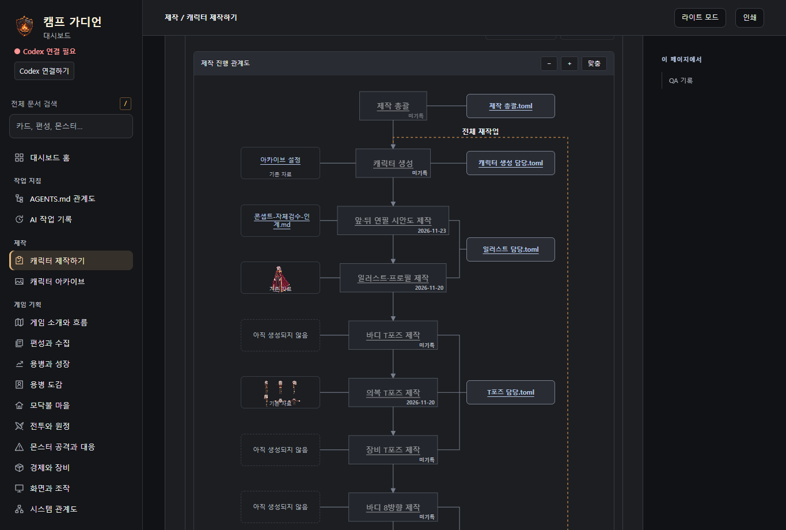
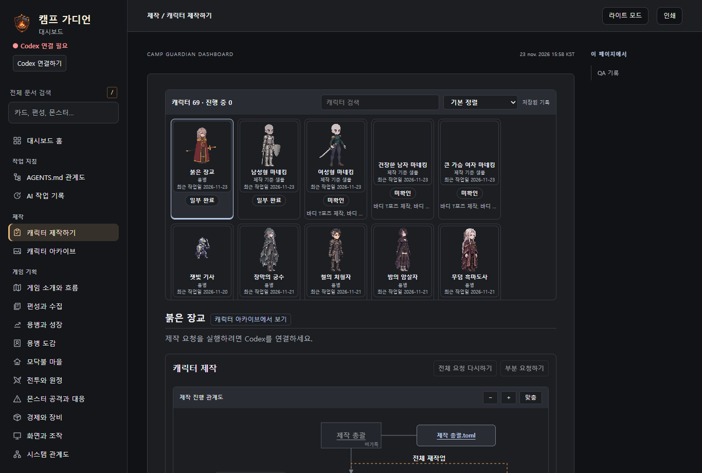
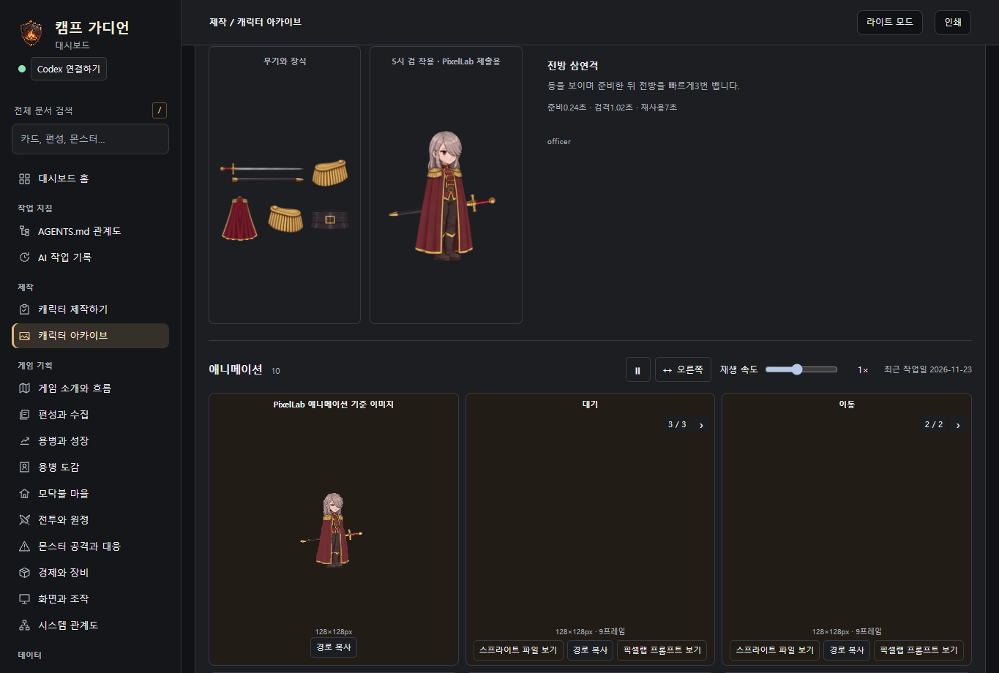

## 작업 결과

## 변경 내용

### 적용 내용

최신 제작 로그·검수·담당 작업 시각과 기존 아카이브 자산 Git 기록을 한국 시간 날짜로 표시합니다. 날짜가 없으면 미기록으로 표시합니다. 프로젝트 ef7ba18f를 main에 푸시했습니다.

## 검증

대시보드 빌드 9.86초. Chrome에서 도형 13개, 제목과 날짜의 간격, 목록 날짜, 붉은 장교에서 잿빛 기사로 선택할 때 날짜 변경을 확인했습니다. 대상 HTML은 16,857바이트 증가했고 캐릭터 패널 수 69개를 유지했습니다.

## 남은 사항

공개 HTTPS 배포와 모바일 표시는 미확인입니다.

## 작업 시간

- 제안 시간: 약 10분
- 실제로 완료된 시간: 약 5분. 2026-11-23 15:54~15:59 KST 구현·검증·프로젝트 푸시.
- XERJ: 미사용 — 로컬 대시보드 빌드와 Chrome 화면 캡처.
