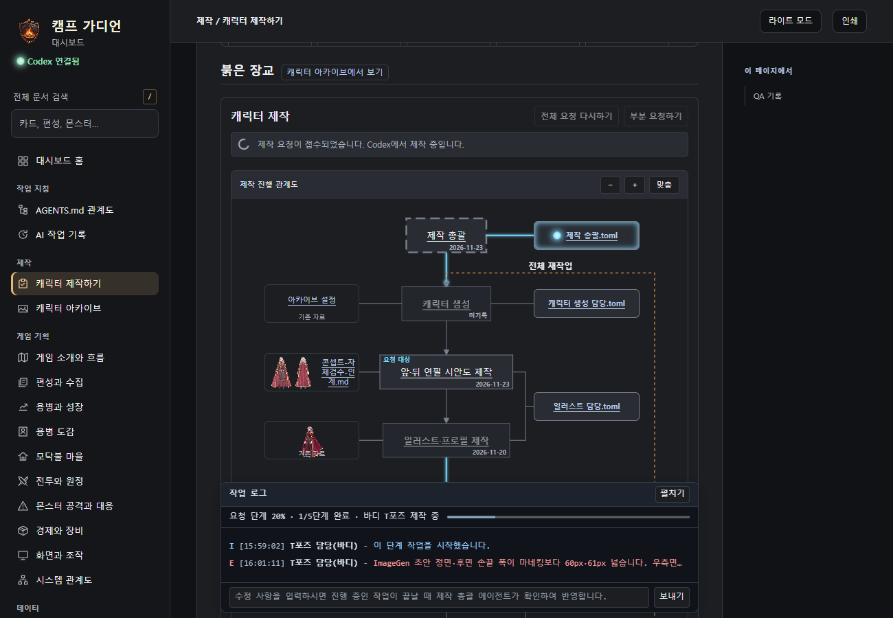
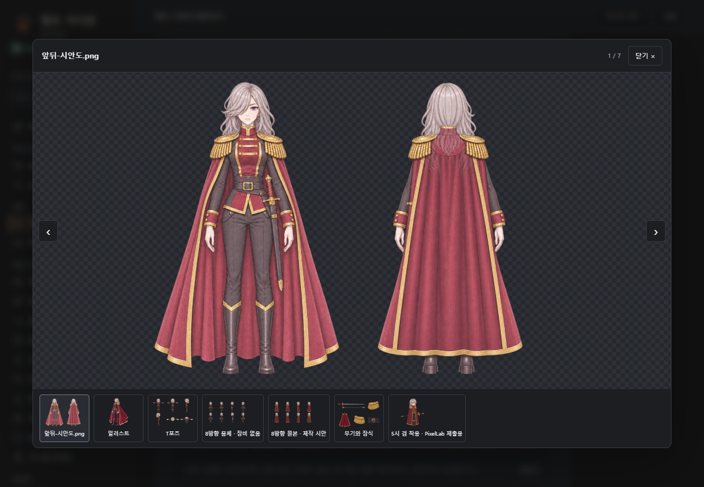

## 작업 결과

## 변경 내용

### 적용 내용

결과 카드의 이미지 우선 표시 및 이미지가 있는 카드에서만 문서 링크 폭을 제한합니다. 대시보드 변경을 38a0c25f로 푸시했습니다.

## 검증

로컬 HTTP 대시보드 Chrome에서 붉은 장교 썸네일 너비 0px 문제를 재현하고 수정 뒤 72×48px로 표시되는 것을 확인했습니다. 클릭으로 1536×1024 PNG 확대, 인계 문서 열기를 확인했습니다. 빌드 18.55초, 커밋의 초기 HTML 크기와 카드 수 동일.

## 남은 사항

공개 배포 미확인. 이번 커밋 범위는 표시 수정입니다.

## 작업 시간

- 제안 시간: 약 5분
- 실제로 완료된 시간: 약 2분 30초. 2026-11-23 16:00:57~16:03:24 KST.
- XERJ: 미사용 — 실제 로컬 HTTP 대시보드 화면과 빌드.
