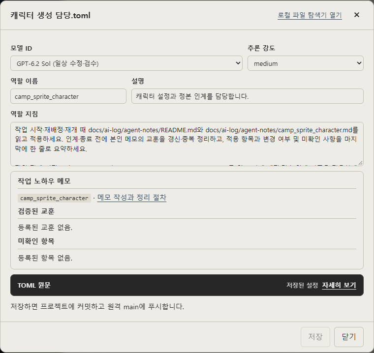

## 작업 결과

역할 설정 모달에 역할별 메모를 표시하고 TOML 원문을 기본 접힘으로 바꿨습니다. 프로젝트 main에 43f4864e를 푸시했습니다.

## 변경 내용

### 적용 내용

빌드에서 역할명과 일치하는 Markdown을 읽어 역할 설정 모달에 표시합니다. 자세히 보기로 TOML 원문을 펼치고 접기로 숨깁니다.

## 검증

Headless Chrome에서 캐릭터 생성 담당의 노하우 메모와 기본 접힘을 확인했습니다. 클릭으로 원문을 펼쳐 해당 역할을 대조한 뒤 Enter로 접었습니다. 빌드 약 2.6초, HTML 3,725,653바이트, 역할 메모 9개를 확인했습니다.

## 남은 사항

로컬 대시보드 트레이와 실제 설정 저장은 미확인입니다. 브라우저 검증에서는 로컬 TOML 읽기 응답에 실제 파일을 사용했습니다.

## 작업 시간

- 제안 시간: 약 5분
- 실제로 완료된 시간: 2026-11-23 16:18 KST 시작, 원격 프로젝트 반영까지 약 3분
- XERJ: 미사용 — 코드 검색 근거가 제공되지 않았습니다.
