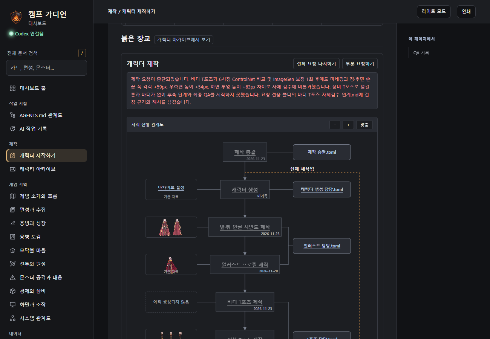
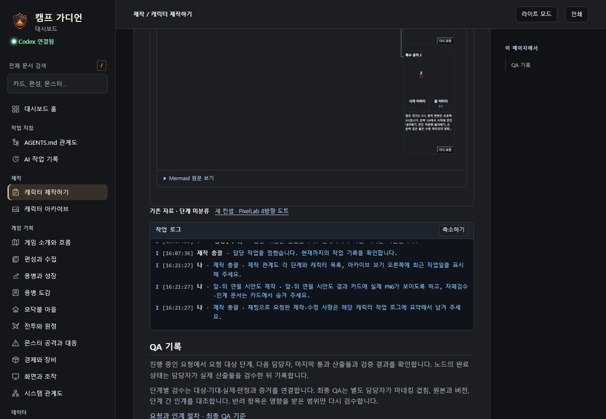

## 작업 결과

## 변경 내용

### 적용 내용

이미지 결과가 있는 카드에서 보조 문서 링크를 숨기고 채팅 요청을 사용자 항목으로 기록합니다. 프로젝트 지침에도 기록 방식을 명시했습니다. 프로젝트 d9fd388b 푸시.

## 검증

로컬 HTTP 대시보드 Chrome에서 문서 링크 부재, 128×49 썸네일, 1536×1024 확대와 사용자 요청 3건을 확인했습니다. 빌드 3.23초, 기존 카드 수 유지.

## 남은 사항

중앙 보고서 공개 배포 미확인.

## 작업 시간

- 제안 시간: 약 5분
- 실제로 완료된 시간: 약 1분 36초. 2026-11-23 16:20:53~16:22:29 KST.
- XERJ: 미사용 — 대시보드 빌드와 Chrome 캡처.
