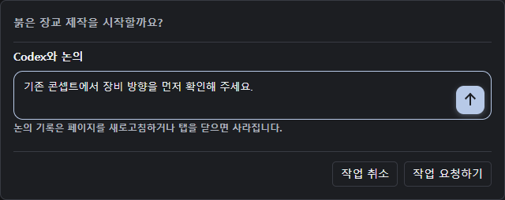

## 작업 결과

제작 대화창의 전송 버튼을 둥근 모서리와 화살표 아이콘으로 정리했습니다. 프로젝트 main에 9d1ed15c를 푸시했습니다.

## 변경 내용

### 적용 내용

공백·대기 중에는 버튼을 비활성화하고 입력이 있으면 강조합니다. 답변을 기다리는 동안 진행 표시를 나타냅니다.

## 검증

Chrome 어두운 테마에서 실제 모달의 강조색, 공백 비활성화, Enter 전송, 응답 대기, 초기화를 확인했습니다. API는 검증 응답을 사용했습니다. 대시보드 빌드 3.2초, 생성 HTML 3,726,657바이트이며 이번 커밋의 HTML은 CSS와 JS 캐시 버전만 갱신했습니다.

## 남은 사항

실제 Codex 응답과 공개 페이지 배포는 미확인입니다.

## 작업 시간

- 제안 시간: 약 4분
- 실제로 완료된 시간: 2026-11-23 16:23 KST 시작, 프로젝트 반영까지 약 3분
- XERJ: 미사용 — 코드 검색 근거가 제공되지 않았습니다.
