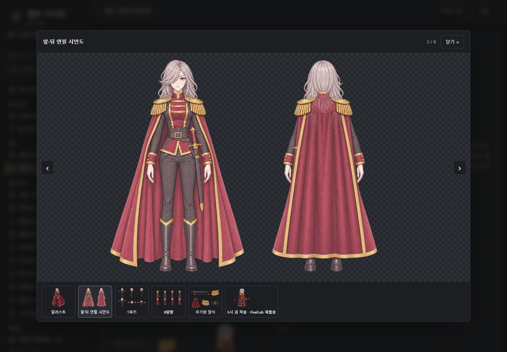
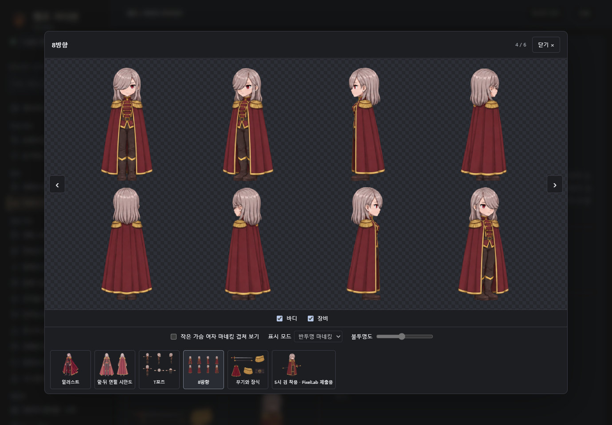

## 작업 결과

## 변경 내용

### 적용 내용

팝업에 본문 대표 이미지와 등록된 시안도를 표시합니다. PixelLab 도트와 검토 중 디자인 시안을 아카이브 이미지 목록에서 제외했습니다. 프로젝트 6187b52f를 main에 푸시했습니다.

## 검증

Chrome에서 아카이브 69개 항목의 분류, 붉은 장교 시안도 확대와 8방향 레이어, 잿빛 기사 T포즈·8방향 묶음을 확인했습니다. 빌드 2.99초, HTML 6382바이트 증가, 등록 이미지 1253개에서 1252개로 감소.

## 남은 사항

공개 배포 미확인.

## 작업 시간

- 제안 시간: 약 5분
- 실제로 완료된 시간: 약 2분 21초, 2026-11-23 16:25:13~16:27:34 KST.
- XERJ: 미사용 — 대시보드 빌드와 Chrome 캡처.
