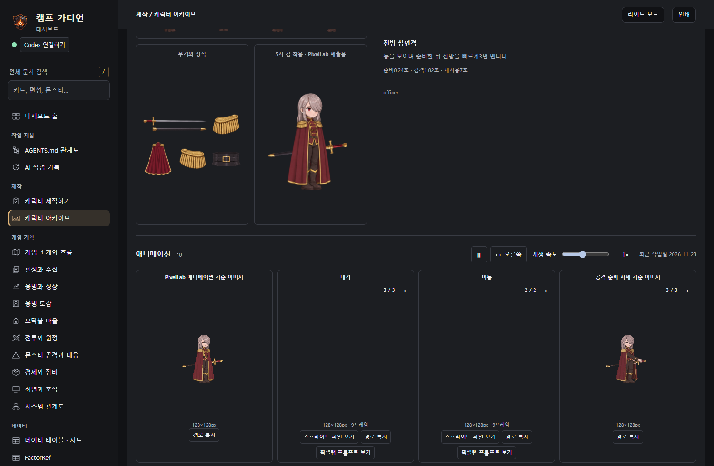
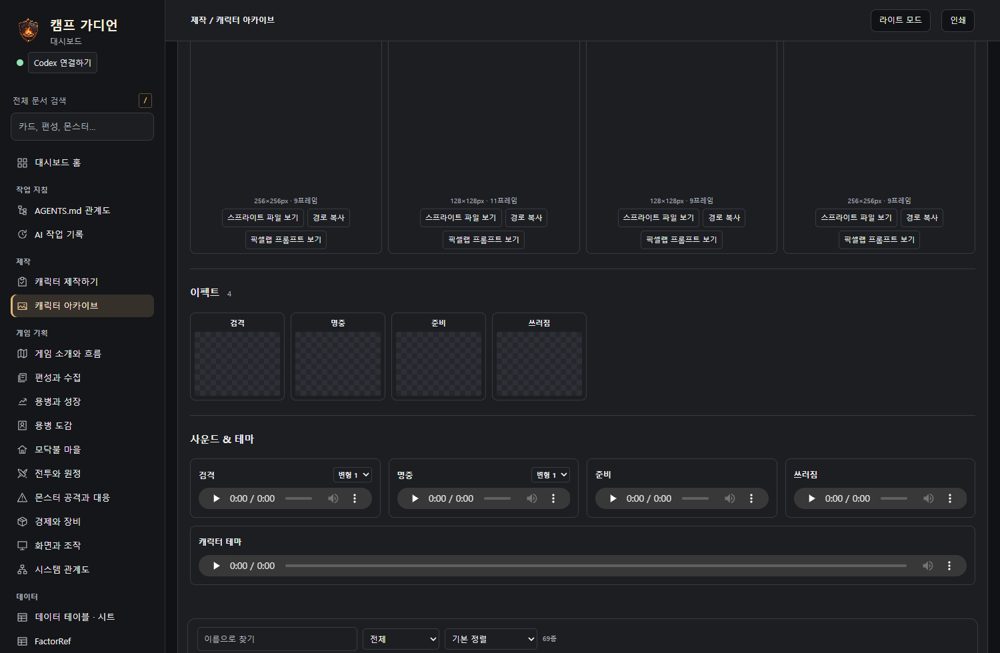

## 작업 결과

## 변경 내용

### 적용 내용

갈색을 강제하던 레거시 규칙을 정리하고 슬롯과 버전 선택 UI에 대시보드 공통 색상을 적용했습니다. 프로젝트 0b83d021 푸시.

## 검증

Chrome에서 애니메이션과 이펙트 612개 전부 다크 #1c1e22와 라이트 #eeece6 확인. 버전 선택 색상 확인. 빌드 9.64초, 이미지 수 1252개 유지.

## 남은 사항

공개 배포 미확인.

## 작업 시간

- 제안 시간: 약 3분
- 실제로 완료된 시간: 약 2분 7초, 2026-11-23 16:28:24~16:30:31 KST.
- XERJ: 미사용 — 대시보드 빌드와 Chrome 캡처.
