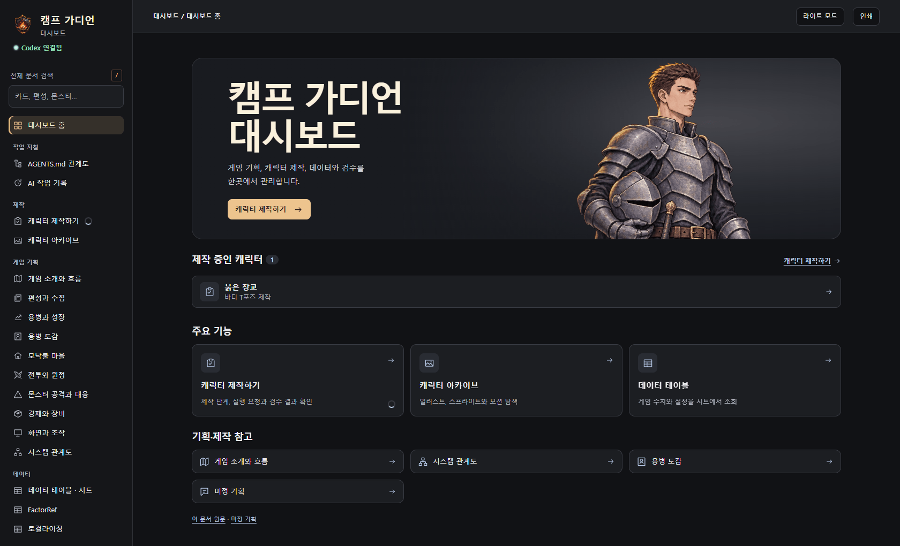

## 작업 결과

## 변경 내용

### 적용 내용

기존 제작 중 상태와 로딩 아이콘을 연결했습니다. 동작 줄이기 환경에서는 고정 표시합니다. 프로젝트 5e198fa1 푸시.

## 검증

Chrome에서 테스트 응답으로 대기 숨김, 진행 시 두 위치 표시, 완료 후 숨김, 다른 탭에서 갱신, 동작 줄이기를 확인했습니다. 실제 브라우저 GIF 8프레임. 빌드 8.99초, 초기 HTML 521바이트 증가.

## 남은 사항

공개 배포 미확인.

## 작업 시간

- 제안 시간: 약 4분
- 실제로 완료된 시간: 약 2분 9초, 2026-11-23 16:31:16~16:33:25 KST.
- XERJ: 미사용 — 대시보드 빌드와 Chrome 캡처.
