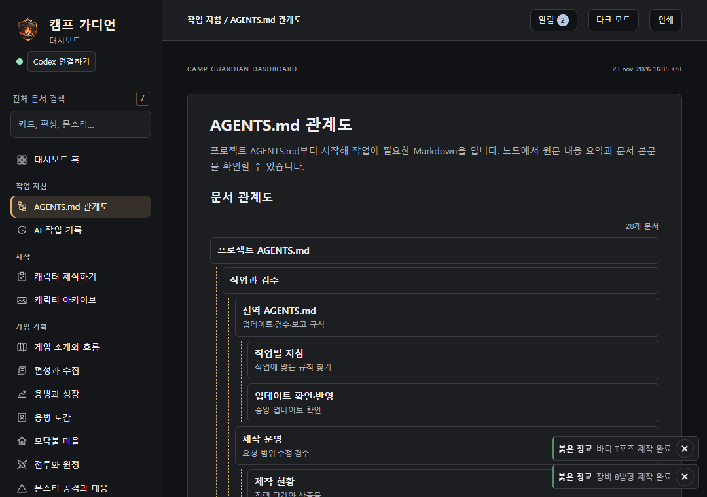

## 작업 결과

제작 완료 알림, 브라우저 권한 요청, 토스트 기록, 개별·전체 확인을 적용하고 프로젝트 main에 cb8f4009를 푸시했습니다.

## 변경 내용

### 적용 내용

열린 대시보드에서 제작 상태 갱신을 감시하고 새로 완료된 단계의 캐릭터 이름과 단계명을 토스트에 표시합니다. 브라우저 알림은 권한이 허용됐을 때 발송을 요청합니다. 전체 토스트의 내용을 브라우저에 보관하고 미확인 건수를 상단에 표시합니다.

## 검증

Chrome에서 테스트용 제작 상태와 브라우저 알림 응답을 사용해 두 단계 완료, 저장 토스트 두 건, 새로고침 후 미확인 4건, 개별 확인과 모두 확인을 검증했습니다. 생성 HTML 3,771,653바이트, 빌드 약 2.3초입니다. 알림 목록은 30건 단위로 표시합니다. 캡처는 실제 대시보드 브라우저에서 촬영한 3프레임 GIF입니다.

## 남은 사항

브라우저와 운영체제의 실제 권한 승인 및 시스템 배너 표시, 공개 페이지 배포는 미확인입니다. 사이트가 열린 동안 제작 상태를 감지합니다.

## 작업 시간

- 제안 시간: 약 7분
- 실제로 완료된 시간: 2026-11-23 16:32 KST 시작, 프로젝트 main 반영까지 약 5분
- XERJ: 미사용 — 코드 검색 근거가 제공되지 않았습니다.
