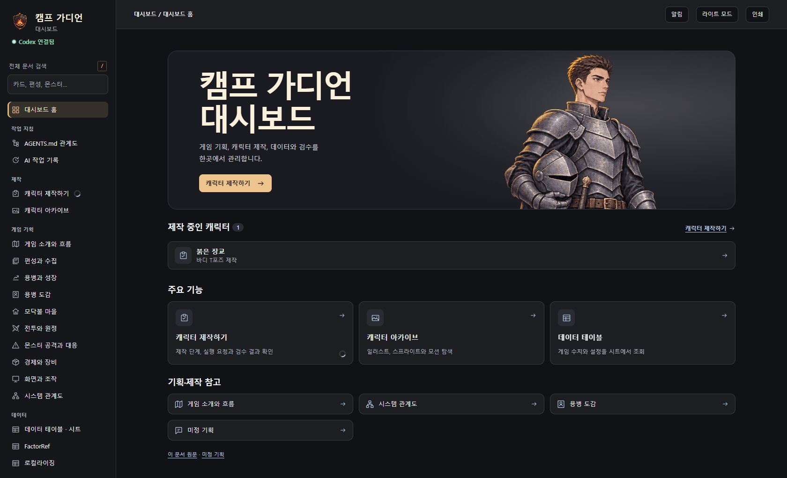

## 작업 결과

## 변경 내용

### 적용 내용

제작 로딩과 아카이브의 동작 감소 분기를 제거하고 프로젝트 지침에 해당 기준을 명시했습니다. acef3d14 푸시.

## 검증

Chrome에서 동작 감소를 활성화하고 제작 아이콘 회전과 상태 전환, GIF 8프레임을 확인했습니다. 대시보드 CSS·JS에서 동작 감소 분기 검색 결과 없음. 빌드 1.72초.

## 남은 사항

공개 배포 미확인.

## 작업 시간

- 제안 시간: 약 3분
- 실제로 완료된 시간: 약 1분 31초, 2026-11-23 16:35:50~16:37:21 KST.
- XERJ: 미사용 — 대시보드 빌드와 Chrome 캡처.
