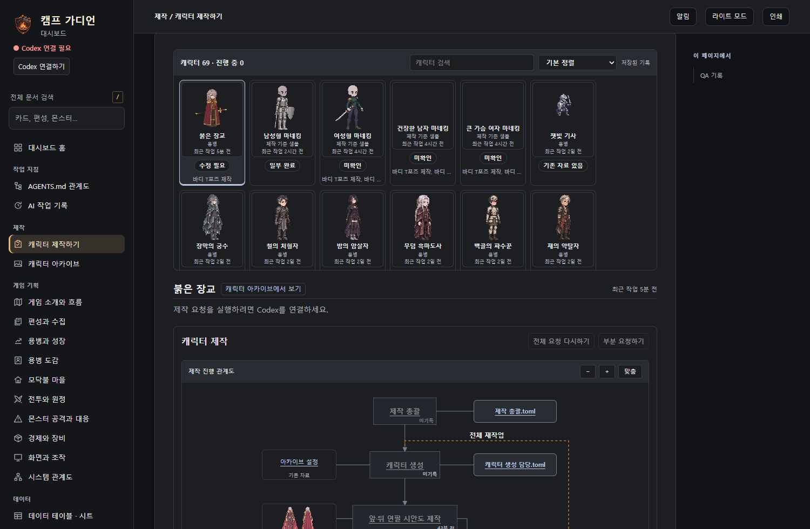

## 작업 결과

## 변경 내용

### 적용 내용

방금 전, 분, 시간, 일 등으로 표시하고 정확한 한국 시각을 마우스 오버로 제공합니다. 2941d1c1 푸시.

## 검증

Chrome에서 방금 전, 1분 전, 5분 전, 1시간 전, 2일 전, 1개월 전과 네 화면 위치의 상대 시간 표시를 확인했습니다. 빌드 2.55초.

## 남은 사항

공개 배포 미확인.

## 작업 시간

- 제안 시간: 약 3분
- 실제로 완료된 시간: 약 1분 11초, 2026-11-23 16:38:52~16:40:03 KST.
- XERJ: 미사용 — 대시보드 빌드와 Chrome 캡처.
