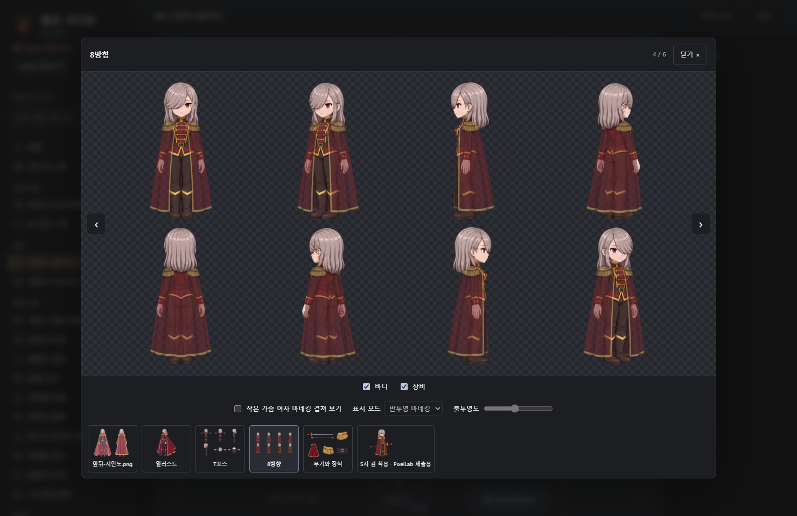
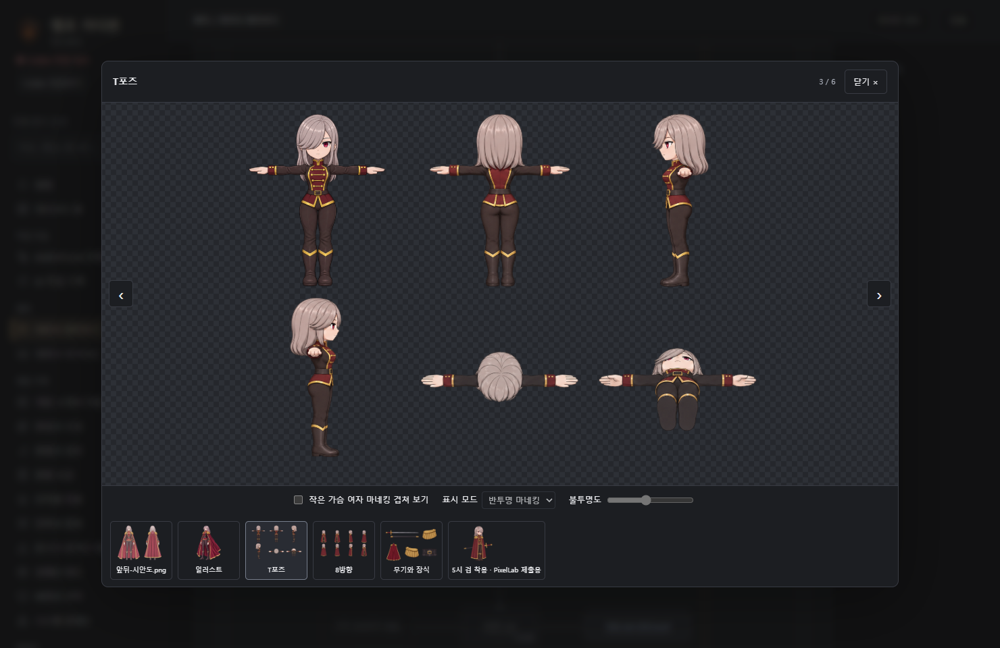

## 작업 결과

## 변경 내용

### 적용 내용

제작 관계도의 단계별 결과를 T포즈와 8방향으로 묶고 실제 바디·의복·장비를 각 그룹에 연결했습니다. a77900f2를 main에 푸시했습니다.

## 검증

Chrome에서 붉은 장교의 제작 관계도 T포즈·8방향과 붉은 장교, 잿빛 기사, 제작 기준 샘플의 아카이브를 직접 확인했습니다. 빌드 성공, 이미지 1252개 유지.

## 남은 사항

공개 배포 미확인.

## 작업 시간

- 제안 시간: 약 4분
- 실제로 완료된 시간: 약 2분 8초, 2026-11-23 16:41:42~16:43:50 KST.
- XERJ: 미사용 — 대시보드 빌드와 Chrome 캡처.
