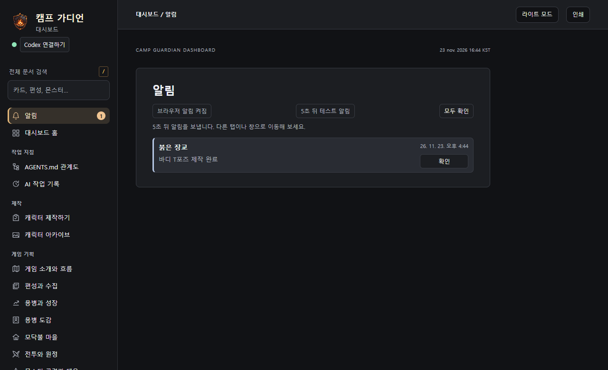

## 작업 결과

알림 탭 이동과 5초 테스트를 프로젝트 main의 bc8c93fe까지 반영했습니다.

## 변경 내용

### 적용 내용

알림은 사이드바 링크에서 본문 페이지로 열립니다. 제작 완료와 테스트에서 공통 Chrome 시스템 알림 경로를 사용하고, 무음 옵션을 해제합니다.

## 검증

Chrome에서 상단 알림 버튼이 없고 사이드바 알림이 한 개이며 홈 바로 위임을 확인했습니다. 직접 주소 새로고침과 미확인 항목 정리를 검증했습니다. 알림 권한이 있는 격리 Chrome 세션에서 다른 탭을 연 후 5초에 실제 Notification 객체가 만들어지고 silent가 false임을 확인했습니다. 대시보드 빌드 약 2.3초, 생성 HTML 3,772,784바이트입니다.

## 남은 사항

Windows 실제 시스템 배너와 스피커 재생, 공개 페이지 배포는 미확인입니다.

## 작업 시간

- 제안 시간: 탭 이동 약 4분, 추가 Chrome 테스트 약 4분
- 실제로 완료된 시간: 2026-11-23 16:39 KST 시작, 프로젝트 반영까지 약 5분
- XERJ: 미사용 — 코드 검색 근거가 제공되지 않았습니다.
