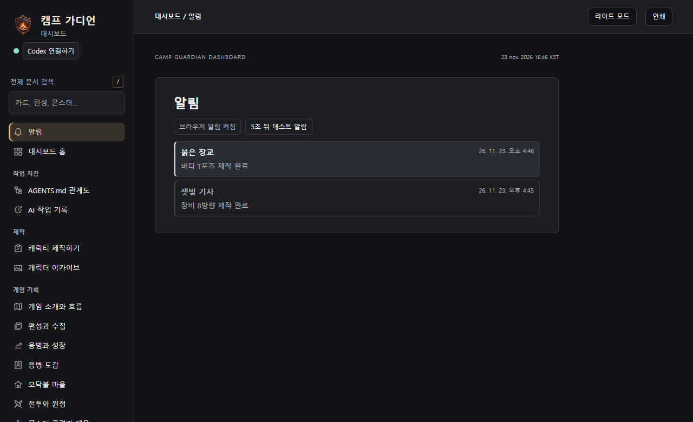

## 작업 결과

알림을 자동 확인하고 이전 항목은 흐리게 표시합니다. 프로젝트 main에 a6ecac8e를 반영했습니다.

## 변경 내용

### 적용 내용

개별 확인과 모두 확인을 제거했습니다. 표시 중인 알림 탭에서 새 기록을 확인 처리하고 현재 방문 동안만 강조합니다. 백그라운드에 있으면 미확인 상태를 유지합니다.

## 검증

Chrome에서 진입 전 배지 1건, 진입 즉시 배지 해제, 새 항목 한 건 강조, 이전 항목 대비, 새로고침 후 강조 해제, 5초 테스트 알림을 검증했습니다. 빌드 2.2초, 생성 HTML 3,772,713바이트입니다.

## 남은 사항

Windows 실제 알림음과 공개 페이지 배포는 미확인입니다.

## 작업 시간

- 제안 시간: 약 3분
- 실제로 완료된 시간: 2026-11-23 16:45 KST 시작, 프로젝트 반영 약 2분
- XERJ: 미사용 — 코드 검색 근거가 제공되지 않았습니다.
