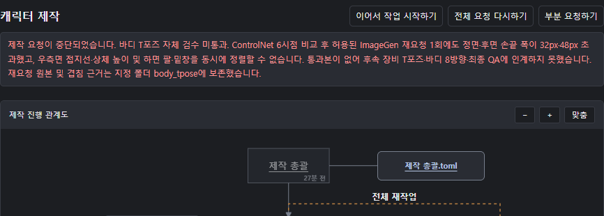
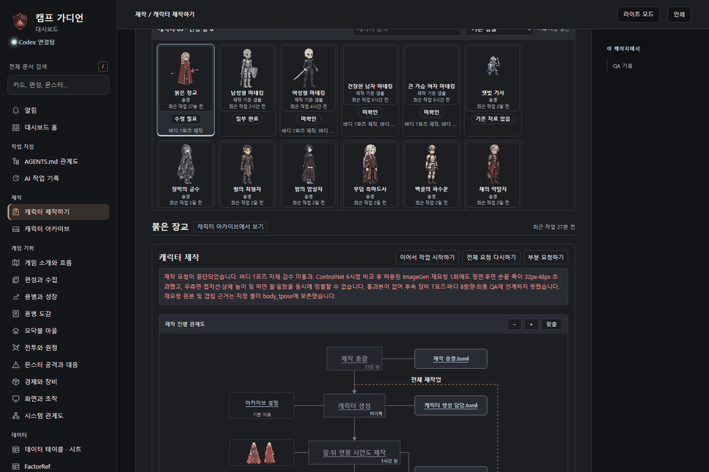

## 작업 결과

캠프 가디언 main에 8b48905b를 푸시했습니다. 붉은 장교의 이전 기록으로 재개 접수까지 확인했습니다.

## 변경 내용

### 적용 내용

이전 중단 사유, 작업 지시, 제작 인계와 산출물 위치를 이어받습니다. 완료 단계의 파일을 해시로 확인하고 첫 미완료 단계 뒤의 이전 요청 범위를 유지합니다. 최종 QA는 이전 요청 범위를 다시 검수합니다.

## 검증

붉은 장교 실기록을 격리해 Windows의 실제 대시보드와 Chrome에서 버튼, 확인창, 재개 접수를 확인했습니다. 작업 실행은 대체했습니다. 이전 기록 및 출력 경로 보존, 중복 접수 차단, 해시 변경 거부, 반복 재개도 확인했습니다. 문서 빌드 3.31초, HTML 3,773,471바이트에서 3,774,984바이트로 증가했습니다.

## 남은 사항

실제 캐릭터 제작과 PixelLab 호출은 실행하지 않았습니다. 기존 별도 작업이 섞인 생성 HTML과 미디어 인덱스는 로컬 빌드 결과로 남겼습니다.

## 작업 시간

- 제안 시간: 10분
- 실제로 완료된 시간: 약 5분, 2026-11-23 16:58~17:03 KST
- XERJ: 미사용 — 코드 검색 근거가 제공되지 않았습니다.
