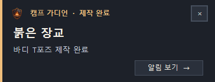

## 작업 결과

프로젝트 main에 8365dcbb를 반영했습니다.

[전용 알림음 WAV](../assets/dashboard-tray-completion-sound-2026-11-23.wav)

## 변경 내용

### 적용 내용

트레이가 제작 상태 파일을 감시해 새로 완료된 단계의 Windows 카드를 표시합니다. 브라우저를 닫아도 트레이는 별도로 작동합니다. 대시보드는 다른 탭에서 탭 제목이 깜박이며 트레이가 없는 브라우저에서 전용 알림음을 켤 수 있습니다.

## 검증

Windows PowerShell 5.1에서 새 완료 감지, 기준 상태 및 중복 제외, WinForms 카드 렌더링, WAV 로드를 확인했습니다. Chrome에서 탭 제목의 두 상태와 돌아올 때 제목 복원, 실제 WAV의 Web Audio 디코딩과 재생 시작을 확인했습니다. 대시보드 빌드 1.6초, 생성 HTML 3,775,722바이트, 추가 WAV 69,164바이트입니다.

## 남은 사항

기존 Windows 트레이 프로세스를 교체하지 않았습니다. 실제 실행 중인 트레이의 데스크톱 카드와 스피커 출력 동시 캡처 및 공개 페이지 배포는 미확인입니다.

## 작업 시간

- 제안 시간: 약 8분
- 실제로 완료된 시간: 2026-11-23 16:57 KST 시작, 프로젝트 반영까지 약 6분
- XERJ: 미사용 — 코드 검색 근거가 제공되지 않았습니다.
