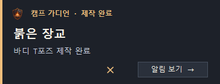

## 작업 결과

프로젝트 main에 d17a1678을 반영했습니다.

[토글 알림음 WAV](../assets/dashboard-tray-toggle-sound-2026-11-23.wav)

## 변경 내용

### 적용 내용

닫기 버튼을 카드 하단 가로 중앙으로 이동했습니다. 배경과 테두리를 없애고 얇은 십자 형태를 직접 그립니다. 알림음은 짧은 접촉과 스위치가 걸리는 소리를 합성한 0.16초 모노 WAV입니다.

## 검증

Windows PowerShell에서 WinForms 카드를 렌더링하고 닫기 버튼의 가로 중앙 및 클릭 시 카드가 숨겨지는 동작을 확인했습니다. WAV를 Windows SoundPlayer로 로드했습니다. 48kHz, 0.16초, 오버샘플 피크 -10.75dBTP입니다.

## 남은 사항

현재 실행 중인 트레이에서의 스피커 출력과 공개 페이지 배포는 미확인입니다.

## 작업 시간

- 제안 시간: 약 3분
- 실제로 완료된 시간: 2026-11-23 17:05 KST 시작, 프로젝트 반영까지 약 1분 35초
- XERJ: 미사용 — 코드 검색 근거가 제공되지 않았습니다.
