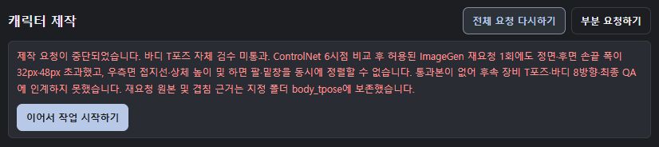

## 작업 결과

대시보드에서 중단 사유 아래 재개 버튼을 확인할 수 있습니다.

## 변경 내용

### 적용 내용

오류 메시지 상자 안에서 재개 버튼을 왼쪽 정렬했습니다. 재개는 채운 버튼, 전체 요청은 강조 테두리, 부분 요청은 기본 테두리로 적용했습니다.

## 검증

헤드리스 Chrome의 밝은 모드와 어두운 모드에서 세 버튼의 위치와 스타일, 기존 오류 색상 및 재개 확인창을 확인했습니다. 마지막 로컬 문서 빌드는 약 2.8초입니다.

## 남은 사항

공개 페이지 배포와 모바일 브라우저는 미확인입니다. 별도 작업이 포함된 생성 HTML은 로컬에 보존했습니다.

## 작업 시간

- 제안 시간: 3분
- 실제로 완료된 시간: 약 3분, 2026-11-23 17:06~17:09 KST
- XERJ: 미사용 — 코드 검색 근거가 제공되지 않았습니다.
