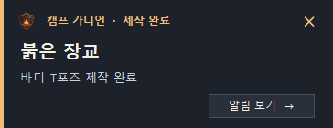

## 작업 결과

프로젝트 main에 64aa1d7e를 반영했습니다.

[맑은 토글 세 번 WAV](../assets/notification-three-toggle-2026-11-23.wav)

## 변경 내용

### 적용 내용

닫기 버튼을 기존 오른쪽 위 좌표에 복원하고 아이콘을 자체 그리기로 정렬했습니다. 알림 탭만 점멸하며 브라우저 제목에는 미확인 수가 1건 이상일 때 숫자 접두어가 붙습니다. WAV는 맑은 접촉과 공진을 세 번 합성합니다.

## 검증

Chrome에서 (1) 접두어, 알림 페이지 진입 시 숫자 제거, 5초 테스트 후 탭 점멸과 안정된 브라우저 제목, WAV 재생 시작을 확인했습니다. Windows 카드의 기존 위치와 버튼 클릭을 확인했습니다. WAV 0.62초와 세 파형 그룹을 검증했습니다. 대시보드 빌드 약 2.8초, HTML 3,775,809바이트입니다.

## 남은 사항

현재 실행 중인 트레이의 스피커 출력과 공개 페이지 배포는 미확인입니다.

## 작업 시간

- 제안 시간: 약 5분
- 실제로 완료된 시간: 2026-11-23 17:09 KST 시작, 원격 반영까지 약 3분
- XERJ: 미사용 — 코드 검색 근거가 제공되지 않았습니다.
