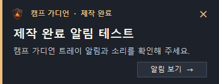

## 작업 결과

프로젝트 main에 3f07e4ee와 닫기 렌더링 수정 4786d5b5를 반영하고 실제 트레이와 서버를 재시작했습니다.

## 변경 내용

### 적용 내용

로컬 대시보드 테스트 버튼이 서버를 통해 트레이에 실행 시각을 전달합니다. 파비콘에 미확인 점을 추가하고 알림 확인 시 복원합니다. 닫기 컨트롤은 카드 바탕과 X 전체를 직접 그립니다.

## 검증

Chrome에서 테스트 버튼의 요청, 파비콘 생성 및 초기화, Windows 소비 코드의 5초 후 1회 처리와 다른 출처 거부를 확인했습니다. 실행 중인 트레이의 실제 알림 화면과 Windows 창 캡처를 비교하고 닫기 영역에서 X 외 픽셀이 없는 것을 확인했습니다. 알림 화면과 캡처 검증은 요청 후 5.95초에 마무리했습니다. 빌드 1.7초, HTML 3,776,195바이트입니다.

## 남은 사항

실제 스피커 출력 및 공개 페이지 배포는 미확인입니다.

## 작업 시간

- 제안 시간: 사이트 테스트 연결 약 4분
- 실제로 완료된 시간: 2026-11-23 17:16 KST 시작, 추가 파비콘과 닫기 잔상 검증을 포함하여 프로젝트 반영 약 7분
- XERJ: 미사용 — 코드 검색 근거가 제공되지 않았습니다.
