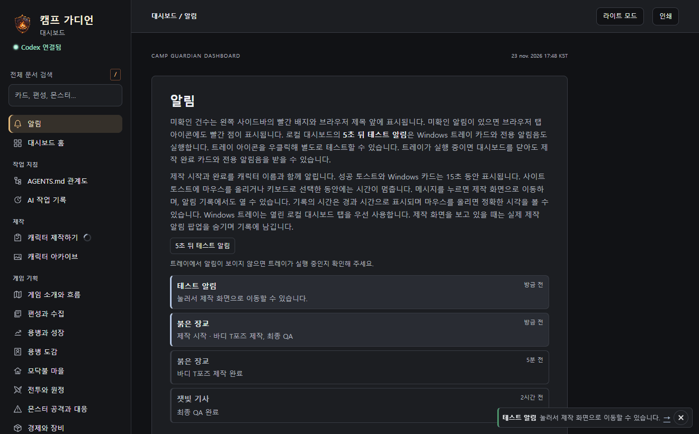
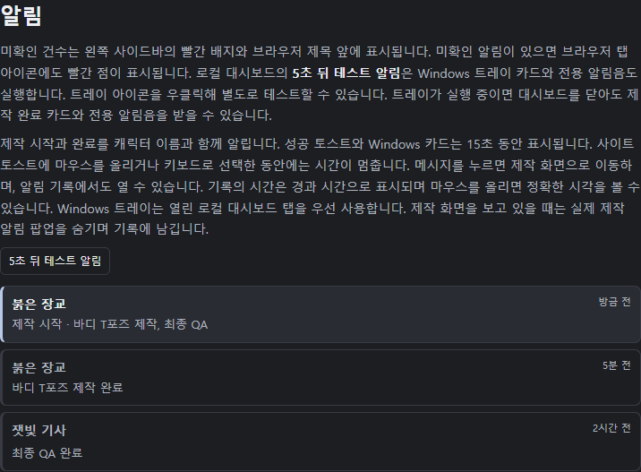

## 작업 결과

프로젝트 main에 50f737ec를 반영하고 진행 중인 독립 제작 실행기를 유지한 채 트레이와 서버를 갱신했습니다.

## 변경 내용

### 적용 내용

성공 토스트를 15초 표시하고 마우스·키보드 상호작용 동안 시간을 멈춥니다. 테스트 토스트의 제작 단계는 Windows 카드와 알림 기록에 함께 전달합니다. 접수 후 제작이 시작될 때 요청당 한 번 알립니다. 알림 시간은 경과 시간과 정확한 시각의 툴팁으로 표시합니다.

## 검증

격리된 실제 Chrome과 로컬 서버에서 5초 테스트 버튼을 눌러 6.5초 보이는 토스트와 9.2초 추가 호버 유지, 카드 여백 클릭, 알림 기록 클릭으로 같은 제작 단계 이동을 확인했습니다. 대기 중에는 시작 알림이 없고 시작 전환 후 한 건만 쌓였으며 방금 전·5분 전·2시간 전을 확인했습니다. PowerShell 5.1에서 Windows 트레이 테스트의 대상 전달과 새 시작 중복 방지를 확인했습니다. 빌드 1.6초, HTML 3,832,326바이트입니다.

## 남은 사항

실제 Windows 카드 15초 실측과 스피커 출력, 공개 사이트 배포는 미확인입니다.

## 작업 시간

- 제안 시간: 토스트 약 5분, 추가 시작 알림과 시간 표시 약 4분
- 실제로 완료된 시간: 2026-11-23 17:43 KST 시작, 로컬 반영까지 약 7분
- XERJ: 미사용 — 코드 검색 근거가 제공되지 않았습니다.
