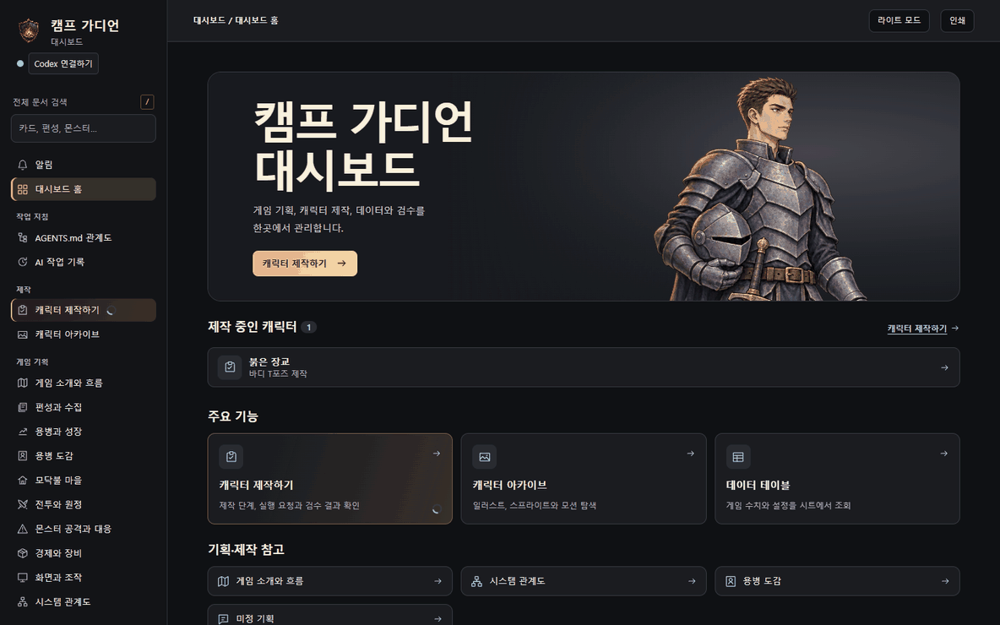

## 작업 결과

프로젝트 main에 5d4bff81을 반영했습니다.

## 변경 내용

### 적용 내용

기존 제작 진행 표시를 기준으로 사이드바 탭, 홈의 상단 제작 버튼과 주요 기능 제작 카드에만 금빛 배경 애니메이션을 적용합니다.

## 검증

Chrome에서 모의 제작 상태로 세 위치의 그라데이션과 배경 위치 변화를 검증했습니다. 상태를 완료로 바꾼 뒤 세 위치의 애니메이션이 중단됐습니다. 대시보드 빌드 3.6초, 생성 HTML 3,832,326바이트입니다. 검증 GIF는 11프레임, 248,061바이트입니다.

## 남은 사항

공개 대시보드 배포는 미확인입니다.

## 작업 시간

- 제안 시간: 약 4분
- 실제로 완료된 시간: 2026-11-23 17:51 KST 시작, 약 3분
- XERJ: 미사용 — 코드 검색 근거가 제공되지 않았습니다.
