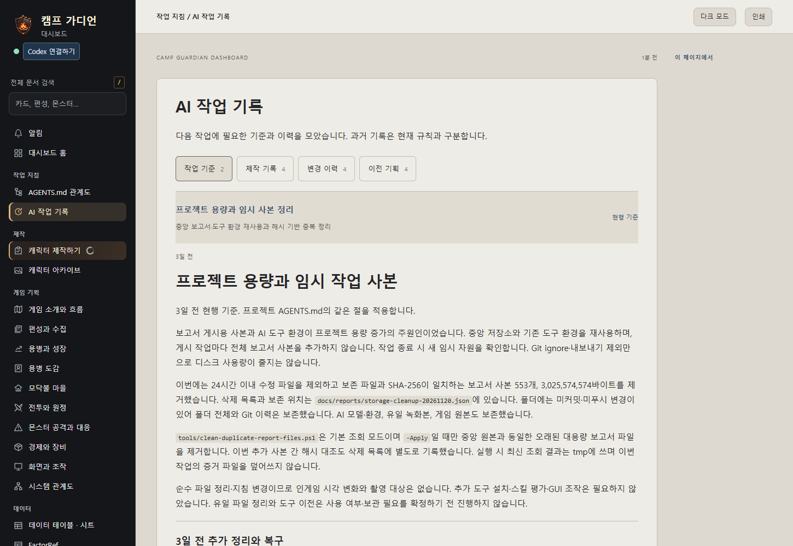

## 작업 결과

대시보드 공통 날짜 표시를 반영하고 프로젝트 main에 푸시했습니다.

## 변경 내용

### 적용 내용

빌드 시각, 문서와 캡션, AI 작업 기록, 제작 로그, 캐릭터 작업 시각, 알림 기록에 공통 상대 시간을 적용했습니다. 시각이 없는 날짜는 툴팁에 날짜만 표시합니다.

## 검증

대시보드 빌드 15.91초. Chrome 헤드리스에서 AI 작업 기록과 빌드 날짜 표시, KST 초 단위 및 날짜 전용 툴팁 값을 확인했습니다. 게시용 HTML 3,734,830바이트에서 3,754,426바이트로 증가. 프로젝트 원격 main bbb10a37 확인.

## 남은 사항

공개 사이트 화면과 중앙 Pages 배포 미확인. 지침 원격 조회 실패. 마지막 로컬 기록 2026-11-22-004.

## 작업 시간

- 제안 시간: 약 8분
- 실제로 완료된 시간: 2026-11-23 17:51~17:56 KST, 작업과 프로젝트 원격 확인까지 약 5분.
- XERJ: 미사용 — 소스, 대시보드 빌드 및 Chrome 렌더링으로 확인.
