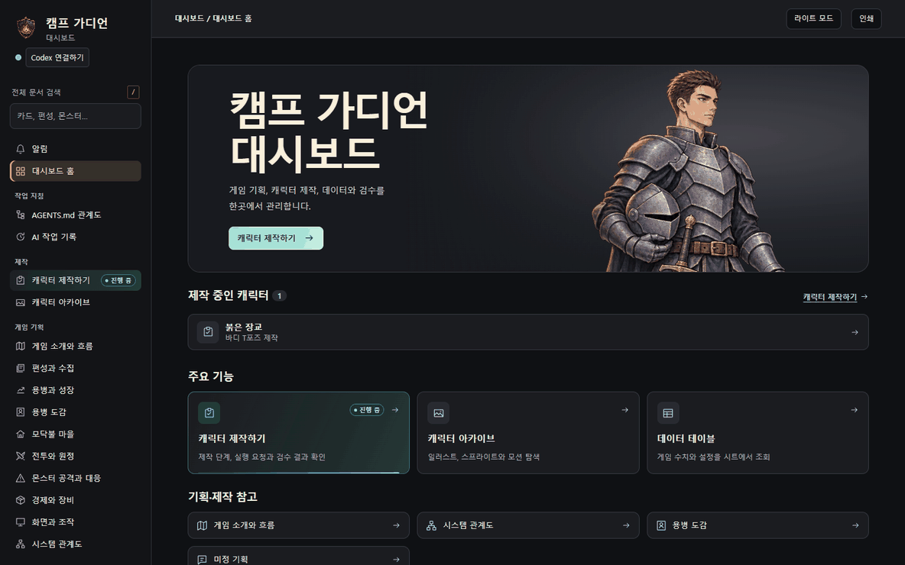

## 작업 결과

프로젝트 main에 d20f5a47을 반영했습니다.

## 변경 내용

### 적용 내용

사이드바 제작 메뉴에 청록색 배경과 진행 중 배지를 표시합니다. 대시보드 홈 상단 버튼은 밝은 청록색 흐름으로, 주요 기능 카드는 상태 배지·강조 아이콘·하단선으로 다듬었습니다.

## 검증

Chrome의 검증용 진행 상태에서 선택 메뉴에 움직이는 진행 배경이 생기지 않는 것을 확인하고, 진행 전용 세 위치의 배경이 움직이는 것을 확인했습니다. 390px 화면에서 카드 배지와 화살표의 간격을 확인했습니다. 상태를 완료로 바꿨을 때 효과가 멈췄습니다. 빌드 약 3.4초, 생성 HTML 3,849,707바이트, 검증 GIF 247,253바이트입니다.

## 남은 사항

공개 페이지 배포는 미확인입니다.

## 작업 시간

- 제안 시간: 약 4분
- 실제로 완료된 시간: 2026-11-23 17:56 KST 시작, 약 3분
- XERJ: 미사용 — 코드 검색 근거가 제공되지 않았습니다.
