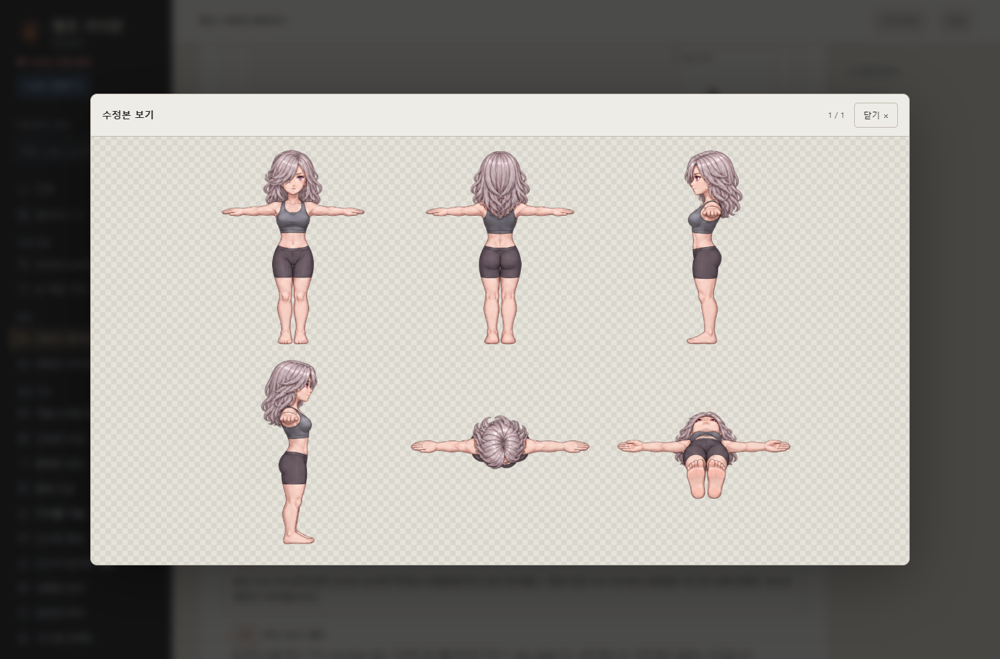

## 작업 결과

## 변경 내용

### 적용 내용

붉은 장교의 첫 초안과 수정본 로그 두 건에 각각 시안과 마네킹 겹침 링크를 추가했습니다. 새 로그도 이미지 경로를 받아 첨부합니다. 프로젝트 main에 a5bbd31c를 푸시했습니다.

## 검증

대시보드 빌드 27.27초. Chrome에서 링크 네 개의 실제 PNG 표시 및 Esc 닫기를 확인했습니다. 참조 이미지 네 개의 합계는 6,053,706바이트이며 모달을 열 때 요청합니다.

## 남은 사항

대시보드 및 중앙 보고서의 공개 배포 확인이 남았습니다.

## 작업 시간

- 제안 시간: 약 8분
- 실제로 완료된 시간: 약 3분, 2026-11-23 18:02 KST 프로젝트 푸시 확인
- XERJ: 미사용 — 코드 검색 근거가 제공되지 않았습니다.
